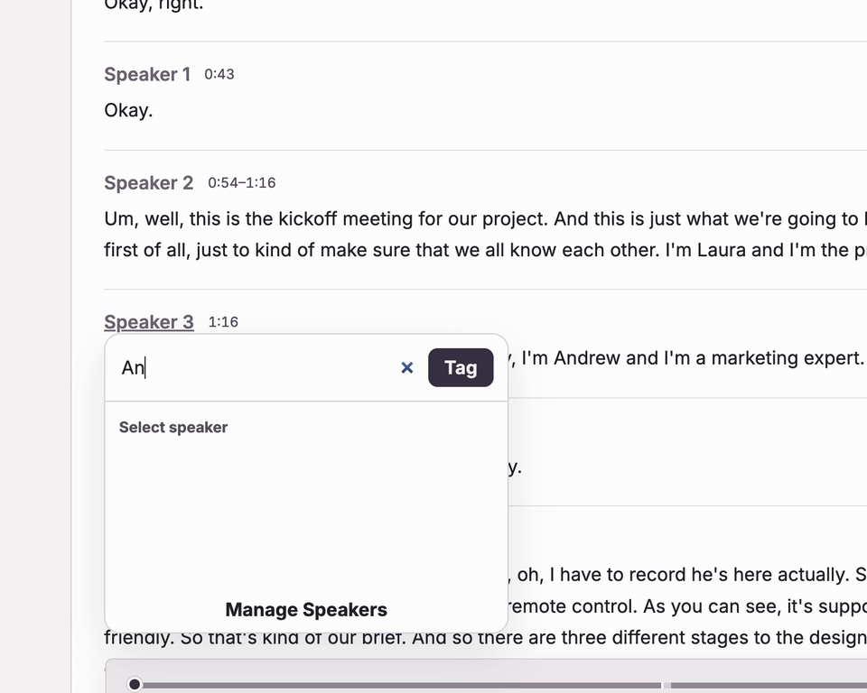
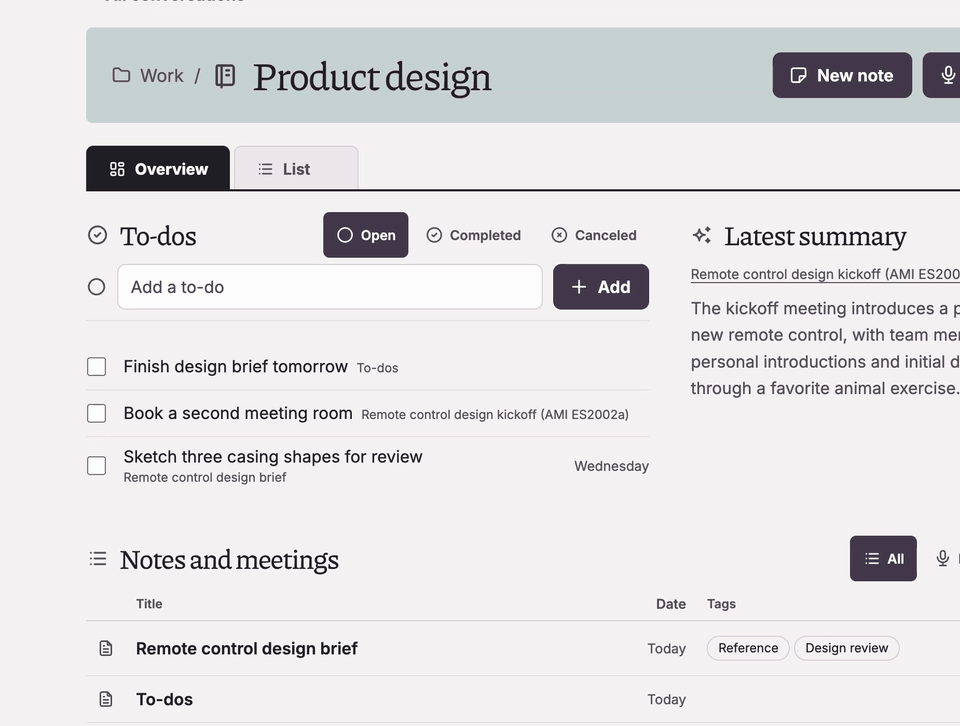
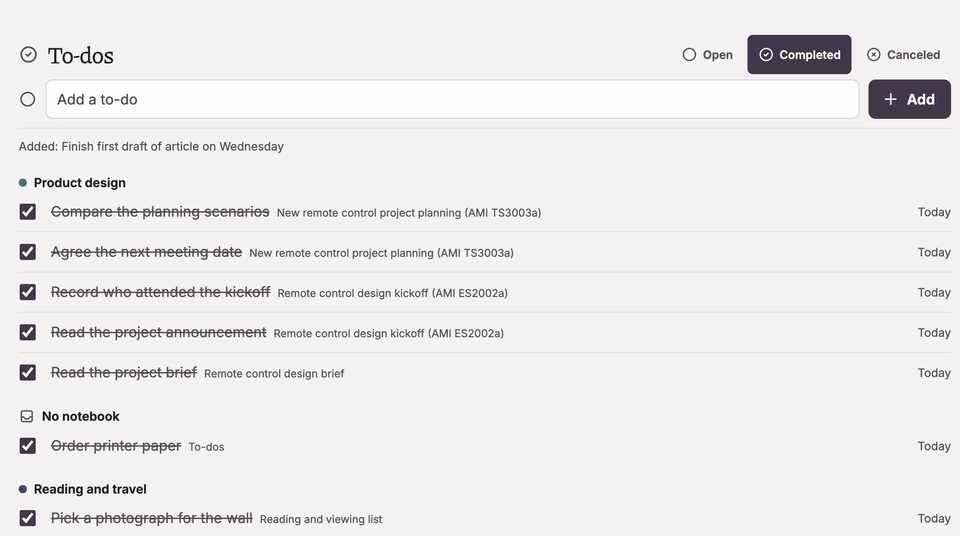

<p align="center"></p>

# Stellis

Stellis is a local workspace for recording conversations, reviewing transcripts, and keeping notes and to-dos together. It runs in your browser while transcription and speaker grouping run on your computer. Connect Nebius for linked summaries, questions about meetings, and follow-up suggestions.

## Get started

Install [uv](https://docs.astral.sh/uv/getting-started/installation/), which sets up Python 3.12 and Stellis's dependencies, then run:

```sh
git clone https://github.com/reversely/stellis.git
cd stellis
uv run stellis
```

Open <http://127.0.0.1:8765/>. The first start downloads about 500 MB of speech models and verifies them; allow about 1.5 GB of free disk space for Stellis and its models. The home page shows download progress. You can run `uv run stellis setup` to download the models ahead of time, or `uv run stellis doctor` to check the installation.

Choose **Sign up** to create the account for this computer's Stellis data. Use a password of at least 12 characters and keep it safe: there is no password reset. To explore first, choose **Add sample workspace** on Home. It adds example collections, notebooks, notes, and to-dos, then downloads about 110 MB for three licensed sample meetings. A short tour opens after sign-up and is available again from Home's **⋯** menu.

To use summaries, meeting questions, transcript cleanup, automatic tags, and to-do suggestions, create a [Nebius Token Factory project key](https://tokenfactory.nebius.com/project/api-keys) and paste it into **Account settings → AI features**. Stellis saves the key in its private data folder and does not display it again.

## What you can do

### Record, import, and review

Record from your microphone or import an MP3 of up to 1 GB. A provisional transcript appears as you record. Stellis transcribes English speech locally, groups passages by speaker, and gives words playback times. Click a word to hear it, search within the transcript, name a speaker, or correct the wording. You can also highlight and comment on passages, and make a separate Edited Transcript while keeping the source transcript.



### Keep meetings and notes together

Collections group notebooks; each notebook brings together meetings, notes, a latest summary, and its to-dos. Nebius can summarize a meeting with links to the transcript and answer questions about it. Write your own notes in the Markdown editor with tables, callouts, toggles, columns, images, link cards, and a `/` block menu. Notes save as you type. Export a notebook as Markdown or in a format that preserves Stellis to-dos and blocks.



### Follow up with to-dos

Make a to-do in any note with a checkbox. Type a date such as “tomorrow at 3pm” and Stellis gathers the task on Home and the To-dos page. Review open, completed, and canceled items by notebook. Enable the Transcript Agent for a notebook to get suggested task changes from meetings, each linked to a passage; you choose whether to accept them.



The recordings above show the sample workspace. Its meeting audio comes from the [AMI Meeting Corpus](https://groups.inf.ed.ac.uk/ami/corpus/) under CC BY 4.0.

## Connect a calendar

Stellis can show the next 14 days from a Google or Outlook calendar and start a recording with a meeting's title. This read-only connection needs a desktop OAuth client you create: set `GOOGLE_OAUTH_CLIENT_ID` for [Google Calendar](https://developers.google.com/identity/protocols/oauth2/native-app) or `STELLIS_MICROSOFT_CALENDAR_CLIENT_ID` for [Outlook](https://learn.microsoft.com/en-us/entra/identity-platform/scenario-desktop-app-configuration) before starting Stellis. Google also needs the Calendar API enabled; Outlook needs the redirect `http://localhost/api/v1/calendar/microsoft/callback`.

## Your data

Stellis listens on `127.0.0.1`. Audio, transcripts, notes, to-dos, and speaker information are stored on your computer. When you use Nebius, Stellis sends only the transcript or note text needed for that request; audio stays on your computer. Calendar events stay on your computer. Set `STELLIS_DATA_DIR` if you want to choose the local data folder.

Stellis records the microphone, not audio from other apps. Speech models are English-only, and automatic speaker groups and AI output can be wrong. Check the recording before relying on a transcript or summary.

## Learn more

- [User guide](docs/guide/README.md): screens, setup, shortcuts, and privacy
- [How Stellis works](docs/architecture.md)
- [Apache License 2.0](LICENSE) and [third-party notices](NOTICE)
