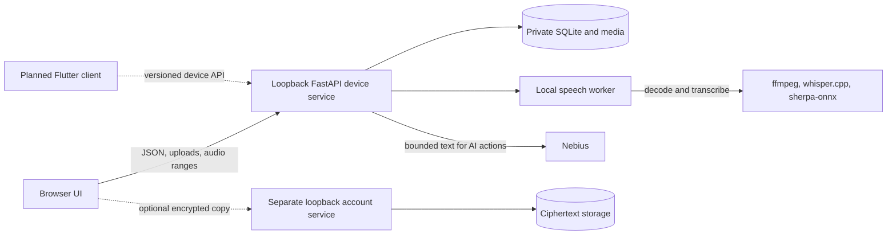

# Stellis

Stellis is a local browser workspace for recording, transcribing, reviewing, and finding interviews. It runs on macOS today. Audio and speech processing stay on the device; AI features send bounded transcript text to Nebius when configured.

The browser is the current product interface. Flutter is planned for iOS and the shared Android/desktop client; it is not part of the running app. The detailed [current architecture](docs/current-architecture.md), [device API contract](contracts/v1.md), and [implementation plan](plans/Personal_AI_Assistant_Implementation_Plan.md) separate shipped behavior from future work.

## What works today

- **Capture and library:** Import MP3 files up to 1 GB or record with the microphone. Recording saves chunks as they arrive, supports pause/resume, provisional local transcription, My Notes, and AI Chat against a saved preview. A recording interrupted by a closed tab can be recovered from acknowledged chunks. The library supports search, categories, optional AI categorization, and Recently Deleted with restore and automatic deletion after 30 days.
- **Local transcription:** `ffmpeg`, whisper.cpp, and sherpa-onnx produce English passages, measured word times, and provisional speaker groups. Rematch speakers uses the saved audio without retranscribing. A new transcription that changes passage IDs while user edits exist waits for explicit review before activation.
- **Listen and correct:** The fixed player supports scrubbing, speed, five-second skips, and optional Skip Silence. Clicking a passage or measured word seeks the recording; playback follows the transcript. Search within a conversation, highlight or comment on selected text, edit multiple passages in one session, and compare an Edited Transcript with the source. Speaker tagging creates reusable Person profiles; speaker names and passage links persist across reloads.
- **Vocabulary:** Separate [Names of people and Other vocabulary pages](docs/decisions/0049-vocabulary-workspace-and-prompt-budget.md) support batch entry, alphabet navigation, editing, moving, and deletion. The stored list can grow; each speech job uses a bounded snapshot of recently changed terms in its Whisper prompt.
- **Notes and AI:** My Notes autosaves during recording and after import. Images can be pasted into notes or attached to a transcript time. A versioned Summary is generated after transcription and can be edited or regenerated. Nebius Nemotron also provides source-linked answers and a reviewable clean transcript. AI output can be wrong; use its source links to check the audio before quoting.
- **Access and sharing:** A local single-workspace sign-in protects the device service by default. Selected transcript text can be copied or downloaded with a device-local source link. An optional, separate loopback account service stores browser-encrypted note entries and one-way encrypted conversation snapshots with audio for read-only access from another signed-in browser.

## Architecture



The device service serves the browser files and `/api/v1`, owns local authentication, stores media and revisioned records, and starts isolated speech jobs. Original audio does not go to Nebius. Summary, answer, clean-transcript, recording-chat, and optional categorization requests send selected transcript or note text; results, source IDs, and provider metadata are stored locally. The optional account service has its own login and ciphertext database. Its current sync path is a one-way copy, without edit replay, deletion propagation, or recovery. The [architecture document](docs/current-architecture.md) records components, data flows, verification, and limits in more detail.

## Install and run

Requires macOS, Python 3.12, [uv](https://docs.astral.sh/uv/), `ffmpeg`, and `whisper-cli`. With Homebrew, install the native tools using `brew install ffmpeg whisper.cpp`. The services bind to loopback.

```sh
uv sync --locked
scripts/setup_models.sh
uv run --locked stellis doctor
uv run --locked stellis serve
```

Open <http://127.0.0.1:8765/>. `scripts/setup_models.sh` downloads and verifies the English Whisper and two sherpa-onnx model files in private local storage. `stellis doctor` reports model and tool readiness. You can set `STELLIS_WHISPER_MODEL`, `STELLIS_SEGMENTATION_MODEL`, or `STELLIS_EMBEDDING_MODEL` to use other local model paths. Use `--port` to change the loopback port.

On first launch, **Sign up** creates the one account for that local data directory. Later, **Sign in**; sessions last seven days. Normal account passwords require at least 12 characters. There is no local password reset. For an explicitly open development workspace, set `STELLIS_AUTH_MODE=open`. For a development account without normal signup, set `STELLIS_DEV_ACCOUNT=1` and `STELLIS_DEV_PASSWORD`, then sign in as `dev`. Keep the same `STELLIS_DATA_DIR` across restarts to retain data and credentials; its default is `~/Library/Application Support/Stellis`.

Set `NEBIUS_API_KEY` in the environment or in an ignored `.env` file to use summaries, questions, clean transcript, recording AI Chat, or optional AI categorization. Import and local transcription work without the key.

## Use the browser workspace

Choose **Import recording** for an MP3 or **Record** for microphone capture. A completed import or recording starts local transcription when the models are ready. Reimporting the same audio opens its existing conversation. To migrate a browser-downloaded Otter ZIP, run `scripts/prepare_otter_migration.py` outside the app, import its MP3, and attach the exported text as a reference; that text does not replace the machine transcript.

Open a conversation to play or scrub its audio. **Notes** contains My Notes and the generated Summary. **Transcript** contains the source wording; **Edited Transcript** appears as a third tab after cleanup. Use the transcript's selection controls for highlights, comments, and sharing, or **Edit transcript** to save wording changes together. Use **More options** for rematching, reprocessing, summary regeneration, and deletion. Open **Vocabulary** from the library to manage speech hints for future processing.

## Optional calendars

The home page can show the next 14 days from a connected Google or Outlook primary/default calendar and start a local recording titled from an event. It does not write events, record automatically, send reminders, or send calendar details to Nebius or the encrypted account service. Provider tokens are stored in `calendar_tokens.sqlite3` under the private local data directory with file mode `0600`; they are not encrypted at rest. **Disconnect** deletes local tokens but does not revoke the provider grant.

For Google, enable the Calendar API in the project that owns your OAuth client. Stellis reads the existing `GOOGLE_OAUTH_CLIENT_ID` and optional `GOOGLE_OAUTH_CLIENT_SECRET` from the ignored `.env` file or process environment. A dedicated `STELLIS_GOOGLE_CALENDAR_CLIENT_ID` can override it. The local callback is `http://127.0.0.1:<port>/api/v1/calendar/google/callback`; an existing Web client must allow that exact redirect, while a [Desktop client](https://developers.google.com/identity/protocols/oauth2/native-app) supports the loopback flow. No Calendar-specific client is required.

For Outlook, register a [Microsoft desktop public client](https://learn.microsoft.com/en-us/entra/identity-platform/scenario-desktop-app-configuration) for the intended account types. Add the mobile/desktop redirect `http://localhost/api/v1/calendar/microsoft/callback`, enable public client flows, and set `STELLIS_MICROSOFT_CALENDAR_CLIENT_ID` to its application ID. Microsoft ignores the port when matching a localhost redirect but matches the path. A work or school tenant may require administrator consent. The connection requests `Calendars.ReadBasic` and `offline_access`.

Both connections use authorization code with PKCE. The callback returns to the browser address where the connection began. A device must be running to refresh meetings. Revoke access in the Google or Microsoft account settings if you also want the provider grant removed.

## Optional encrypted account prototype

Start the separate service with `uv run --locked stellis sync-serve --port 8769` and open <http://127.0.0.1:8769/>. It has independent development accounts and a vault passphrase that the service cannot recover. Browser Web Crypto encrypts note entries before upload and queues them in IndexedDB while offline.

To copy a transcribed conversation, start the account service with `STELLIS_DEVICE_ORIGIN=http://127.0.0.1:8765` and the device service with `STELLIS_SYNC_ORIGIN=http://127.0.0.1:8769`. Sign in and unlock the vault on the account page. In the device conversation, choose **More options → Sync conversation** and enter the same passphrase. The browser encrypts transcript parts and up to 128 MiB of audio; another browser signed into that account can decrypt the read-only copy. Source links to the device work only while that machine's loopback service is reachable. This prototype has no bidirectional edits, deletion sync, device revocation of existing ciphertext, or vault recovery.

## Local data and limits

`.env`, `data/`, `.private/`, private recordings, and generated environments are excluded from Git. Do not put recordings or API keys in issues, pull requests, or tests. The current speech models are English-only. Speaker assignments remain suggestions until confirmed; word times and AI citations should be checked against the recording. The [real-interview speech](docs/validation/real-interview-speech.md) and [word-timing](docs/validation/real-interview-word-timing.md) records describe measured results and remaining gaps.

The [UI style guide](docs/ui-style-guide.md) covers interface decisions. [Architecture decisions](docs/decisions/) explain consequential forks. Run `uv run --locked --with pytest pytest -q` for the project test suite.
