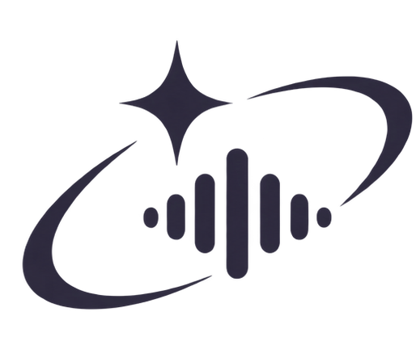

<p align="center"></p>

# Stellis Health

Stellis Health is a hosted assistant for one person's own health records. A person records an appointment, and Stellis Health transcribes it, files it in a notebook with their notes and to-dos, and answers questions about it with links to the passages it used. Language model requests go to open-weight models on Nebius Token Factory.

The alpha runs at <https://stellis-health.fly.dev>. Ticket-sized work toward the three product pillars (education and research, an agent for records and appointments, and tracking of goals and habits) is listed in [plans/health-alpha.md](plans/health-alpha.md).

## Use the hosted app

1. Open <https://stellis-health.fly.dev> and choose **Sign up**. A password needs at least 12 characters. The alpha has no password reset yet; ticket H-04 adds one.
2. Pick what you will use Stellis Health for. Setup creates a notebook and agents for each choice.
3. Choose **Record** to capture an appointment, or import an MP3. Transcription runs on the server's speech models; the first start after a deploy downloads about 500 MB of models before the first transcript appears.

To read a scanned page or photo, open it in Records and choose **Read text**.
Use **Edit text** to correct the result before extracting health facts. Recognition
supports English printed text and runs on the server. The original file stays
available through **Open PDF** or **Open image**. Settings lists timed requests
under **Recent requests**.

## Choose a version

Install [uv](https://docs.astral.sh/uv/getting-started/installation/), then clone this repository. Choose one explicit launch:

```sh
uv run --locked stellis launch local --init
uv run --locked stellis launch local
```

Or, for the managed cloud runtime:

```sh
uv run --locked stellis launch cloud --init
# Edit .private/cloud.env with your cloud gateway and credentials.
uv run --locked stellis launch cloud
```

Local uses NemoClaw and Ollama on GN100. Cloud uses NemoClaw on Nebius Cloud with Token Factory inference. Each has separate configuration, data and a default port. Both currently run speech workers on the Stellis host. [Launch instructions](docs/launch.md) cover prerequisites, configuration checks and the legacy direct mode. [Cloud integration work](plans/nebius-cloud-integration.md) separates the upcoming serverless speech service.

Install Tesseract and English language data for host execution (`tesseract-ocr` and `tesseract-ocr-eng` on Debian or Ubuntu). The deployment image includes and verifies them.

Run the tests with:

```sh
uv run --locked --with pytest python -m pytest -q
node --test tests/*.cjs
```

## Deploy

[docs/deploy-fly.md](docs/deploy-fly.md) covers the Fly.io app, its volume, secrets, Google Calendar setup, backups and logs.

## Your data

- **Storage:** each account has its own SQLite database and media folder on the Fly volume. In the alpha the server can read stored data; client-side encryption is a later milestone.
- **Model requests:** the local version uses GN100 Ollama; the cloud version uses Token Factory. Requests include only the transcript, note or question text needed. Speech currently runs on the Stellis host.
- **Web research:** research agents send their search queries to Tavily.
- **Accuracy:** speech models are English-only, and transcripts, speaker groups and AI answers can be wrong. Check the recording before relying on a transcript or summary.

## Licence

[Apache License 2.0](LICENSE) and [third-party notices](NOTICE).
