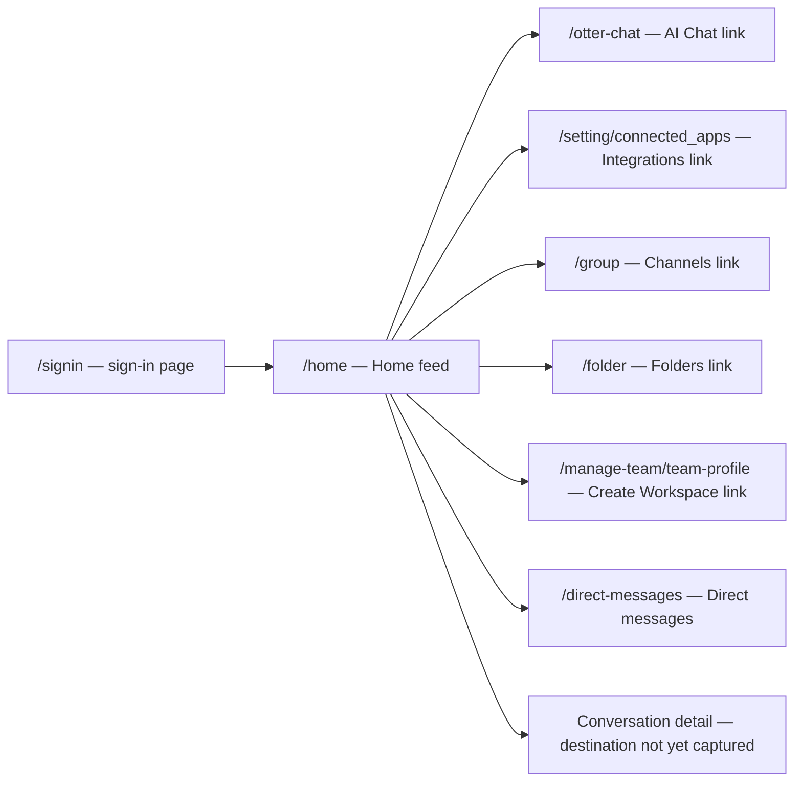

# Site map — discovery pass

Observed on 2026-10-16 in a fresh Chrome profile after the account reached Otter Home. This is a partial route map, not a completeness claim. Account-specific meeting content is omitted.

## Route and state graph

`/signin`, `/home`, `/otter-chat`, `/setting/connected_apps`, `/group`, `/folder`, `/direct-messages`, and `/manage-team/team-profile` have now been directly observed. The diagram paths are navigable destinations, while workflows behind them remain largely untested.

## Additional route states

- `/otter-chat`: an AI Chat composer appeared with a textarea, New chat, Add context, Add file, Chat/Work mode controls, and Send message. No prompt was sent.
- `/setting/connected_apps`: Account Settings showed an integrations discovery list, including calendar, meeting, automation, messaging, email, storage, and notes services. Connect and Request access controls appeared. No connection was started.
- `/group`: an empty Channels state appeared with a New channel control. A chat panel was also visible after navigating from AI Chat; persistence needs verification.
- `/folder`: an empty Folders state appeared with a New folder control.
- `/direct-messages`: an empty Direct messages state appeared with a New message control. A chat panel was visible in this session.
- `/manage-team/team-profile`: a team creation prompt appeared alongside “You do not have access to manage your workspace.” Its Create a Team link pointed to `/purchase/team?utm_content=web_app`; no purchase path was followed.

## Home (`/home`)

- A compact left navigation rail was visible at an 800 × 600 viewport. It exposed Home, AI Chat, Integrations, Channels, direct messages, and Folders. The Home control was selected.
- The top and page controls exposed search (`⌘K`), Import, Record, notifications, Upgrade, and desktop-app download.
- A banner offered Zoom connection, Learn more, and dismissal.
- The Home feed showed date-grouped conversation cards. Each card linked to conversation details; some showed expandable summaries. Titles, summaries, and account identifiers are deliberately excluded from this repository.
- Additional visible entry points included Meetings, Action Items, and Create Workspace.
- A sidebar toggle changed its accessible label from “Open sidebar” to “Close sidebar” when clicked. Its expanded layout still needs visual and keyboard verification.

## Evidence

- REA target discovery: `ev_1a26f7804c212fb4ddab2acfe2b243c41eb95918c4c066953391ae841076f510`.
- REA `/home` accessibility and DOM inspection: `ev_870d788a5f039e4a18b1a52dc56827990d992482a57185844961714e7978bde5`.
- REA route captures: AI Chat `ev_d86cf8582235fc7f7abaf7b4c4cd2fc58640ff53f1d265c3f3fb8bec75f7ee57`; Integrations `ev_345bf1cd90667b2e452113fc3d8573627a27c7ba0d656e739745cd6134d0ecee`; Channels `ev_53af4fa2243cef388c43341af3cf285f4d866d4534e3bf323dcd3133c1096fc5`; Folders `ev_209221203f8c2bce46e0ae2478c0179c9ea4e3e362e4f71a18c84b777b0ca287`; Team profile `ev_3e20d9dfaec99af409f93af73fea4eb7311bdd6bdee76d587901b0022ea80e01`; Direct messages `ev_a266f69112abb0f34a00d23f9c140437668d7feb9c2cdf7958b9b3493e8671ac`.
- Local navigation-only crop: [`evidence/home-navigation-compact.png`](evidence/home-navigation-compact.png).
- Link destinations and sidebar label were checked against the live DOM in the same browser session.

## Next discovery steps

Inspect the expanded sidebar, account menu, overlays, and conversation detail route; then repeat at desktop, tablet, and mobile widths. Capture screenshots that exclude account-specific content.
