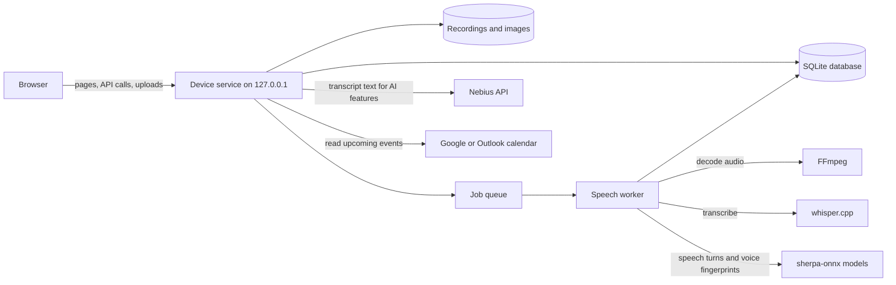

# How Stellis works

Stellis is a local web app. A Python service on your computer stores your conversations and runs speech processing; your browser shows the interface. This page describes the parts and where your data goes, for anyone who wants to understand or change Stellis.

## Parts

| Part | What it does for you | Where it lives |
| --- | --- | --- |
| Browser interface | Records audio, plays recordings, shows transcripts, notes, speakers, and search | `src/stellis/static/` |
| Device service | Signs you in, stores conversations, serves the interface and `/api/v1`, and starts jobs | `src/stellis/server.py`, `storage.py` |
| Speech worker | Transcribes recordings, groups speakers, and fingerprints voices, one job at a time in a separate process | `processing.py`, `worker.py` |
| AI features | Summaries with transcript links, answers, cleanup, and automatic categories through Nebius | `ai.py`, `enhanced_notes.py`, `categorization.py` |
| Calendars | Reads upcoming events from one connected calendar | `calendar.py` |

## Processing a recording

1. **Decode:** FFmpeg converts the recording to 16 kHz mono audio.
2. **Transcribe:** whisper.cpp writes English passages with word timings, using your custom vocabulary as a hint. A stretch where Whisper repeats one phrase is transcribed again by itself, and passages that contain only sound tags are dropped.
3. **Find speech turns:** sherpa-onnx with the Pyannote segmentation model marks where each voice speaks.
4. **Group speakers:** each passage gets a TitaNet voice fingerprint, and spectral clustering groups passages by voice. The number of speakers is estimated, never assumed. Short recordings use the speech turns instead.
5. **Suggest people:** a speaker whose voice closely matches someone you named in other conversations shows that name in grey until you confirm it.
6. **Keep your changes:** when you reprocess, your names, edits, highlights, and comments move to the matching new passages. A passage you edited that no longer lines up is kept as you wrote it.

Each job's progress shows on its conversation card. A job interrupted by a restart resumes when the service starts again.

## Where your data is

Everything is stored under `~/Library/Application Support/Stellis` (or `STELLIS_DATA_DIR`): the SQLite database, original recordings, images, speech models, voice fingerprints, calendar tokens, and your Nebius key, which only your user account can read.

| Leaves your computer | When |
| --- | --- |
| Transcript and note text | Only when you use summaries, chat, cleanup, or automatic categories, sent to Nebius with your key |
| Calendar requests | When a connected calendar refreshes upcoming events |

Audio, recordings, and voice fingerprints never leave your computer.

## Experimental: encrypted copies

`stellis sync-serve` starts a separate local account service that stores encrypted copies of notes and conversations, encrypted in the browser with a passphrase the service never sees. It is a prototype: copies are one-way and read-only, with no editing, deletion sync, or recovery.

## Development

- Tests: `uv run --locked python -m unittest discover -s tests`
- Rebuild the notes editor bundle: `npm ci --ignore-scripts && npm run build:notes`
- `stellis doctor` checks the native tools and models.
