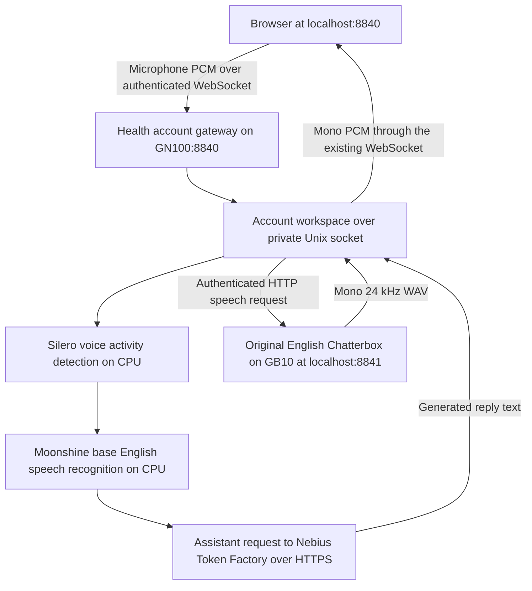

# Local voice runtime on GN100

The integrated reference app runs at **http://127.0.0.1:8840/** on GN100. Create an account, complete or skip setup, and choose **Call Stellis** on My Health. Allow microphone access. The same recognition and synthesis pipeline serves the intake call during setup.

Both listeners bind to GN100 loopback. If the browser runs on a different computer, forward the app port over SSH:

```bash
ssh -N -L 8840:127.0.0.1:8840 springbuilt@100.97.186.57
```

Then open http://127.0.0.1:8840/ on that computer. SSH connectivity requires access to GN100 through the existing tailnet. Loopback HTTP provides the browser's trusted local context for microphone access. Neither public DNS nor Funnel participates in this route.

## Running services

| Component | Listener | User systemd service |
| --- | --- | --- |
| Health app and account gateway | `127.0.0.1:8840` | `stellis-health-chatterbox-app.service` |
| Chatterbox GPU synthesis | `127.0.0.1:8841` | `stellis-health-chatterbox-speech.service` |
| Account workspace processes | Private Unix sockets under the isolated data directory | Children of the Health app |



The speech models and microphone processing run locally. Assistant reply generation uses the existing Nebius Token Factory credential. This reference is therefore local speech with hosted assistant inference. No new Nebius speech endpoint or Fly deployment was created.

The source checkout is `/home/springbuilt/stellis-health-dev/.agents/worktrees/chatterbox-local`, based on commit `f7733fe` plus the configurable Chatterbox port and reference documentation. This preserves unrelated uncommitted work in the primary checkout. The app uses `/home/springbuilt/stellis-health-dev/.venv`; Chatterbox uses its isolated environment at `/home/springbuilt/.local/share/stellis-chatterbox/venv`.

## Files and credentials

The runtime root is `/home/springbuilt/.local/share/stellis-health-chatterbox`:

- `app.env`: backend `local`, speech URL `http://127.0.0.1:8841`, speech bearer token, assistant configuration and model paths.
- `speech.env`: the matching bearer token, CUDA device and port `8841`.
- `workspace/`: isolated account registry, account workspaces and saved app data.
- `models/call/`: installed Silero, Moonshine and Kitten models. Kitten remains available for the CPU backend and test-fixture voice.

Both credential files have mode `0600`. The existing recording-transcription and diarization models are referenced from `/home/springbuilt/stellis-data/models/`; existing account databases and recordings are not reused. Ports 8765 and 8821 and the older standalone TTS server on 8010 are unchanged. The old Funnel configuration targets 8010 and is unrelated to this integrated reference.

## Operation

```bash
systemctl --user status stellis-health-chatterbox-app stellis-health-chatterbox-speech
systemctl --user restart stellis-health-chatterbox-app
systemctl --user stop stellis-health-chatterbox-app stellis-health-chatterbox-speech
```

The services are running and restart after a process failure. They are not enabled at boot. The app service starts the speech service when needed; Chatterbox finishes model loading and startup synthesis before listening.

To switch the app's speech provider, change `STELLIS_TTS_BACKEND` in the private `app.env` and restart the app service. `cpu` uses Kitten; `local` uses the authenticated service on 8841. `nebius` additionally requires a real `STELLIS_CHATTERBOX_NEBIUS_URL` and `STELLIS_CHATTERBOX_NEBIUS_TOKEN`. Restarting the gateway also ends its account subprocesses. No automatic provider fallback is configured.

## Browser evidence

The real browser test clicked **Call Stellis** and supplied a generated microphone fixture saying “I would like to walk more often.” The browser sent 585 PCM frames. The actual Moonshine recognizer emitted “I would like to walk more often,” and the configured assistant produced a reply. The browser received two 24 kHz speech messages and scheduled two audio buffers for playback, covering the opening and the assistant's response. No speech or recognition model was mocked. Physical microphone hardware and a person's subjective listening quality remain separate checks.

The reproducible browser test is `tests/browser/chatterbox_call.mjs`. Set `STELLIS_TEST_MICROPHONE_WAV`, `STELLIS_BROWSER` and, if needed, `STELLIS_PLAYWRIGHT_MODULE`; it defaults to the app on 8840. It creates and removes a disposable account and makes a real assistant inference request. Use an isolated app, and expect its configured provider to receive the fixture text. Evidence files from the reference run are `browser-proof.json` and `browser-proof.png` under the runtime root.
