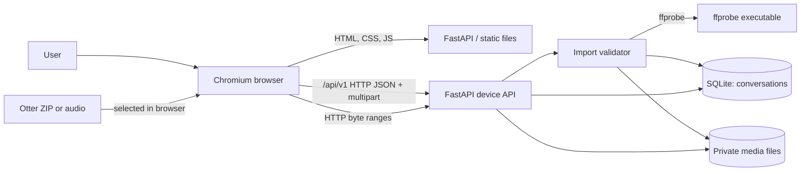

# Current architecture (development)

Last updated: 2026-10-16, ticket #21. This page describes running code on `main` after #21 merges. Proposed components are in [ADR 0003](decisions/0003-cross-client-architecture.md) and are not drawn below.

The browser client shown here is the temporary HTML/JavaScript validation shell. Flutter is required for the deployable web and app UI, but is not yet in this repository's running architecture. Its migration is ticket #25.

## Runtime and ownership

| Component | Current implementation | Owns |
| --- | --- | --- |
| Browser UI | Plain HTML, CSS, and JavaScript in `src/stellis/static/` | File selection/drop, conversation list, player controls, navigation. |
| Device service | FastAPI in `src/stellis/server.py`, started by `uv run stellis serve` | Loopback HTTP (`127.0.0.1:8765`), API routes, static UI, audio range responses. |
| Importer | `src/stellis/importer.py` | Bounded multipart/ZIP extraction, SHA-256 deduplication, `ffprobe` duration/stream validation. |
| Storage | `src/stellis/storage.py` | SQLite conversation index and private original media under `~/Library/Application Support/Stellis` or `STELLIS_DATA_DIR`. |
| Native speech dependencies | `whisper-cli`, sherpa-onnx, model files | Installed or spiked, but not invoked by the app yet. Ticket #12. |
| Hosted services | None in running app | Nebius credentials have only been verified separately; no production AI call path yet. |

## Implemented connections

- `GET /` and `GET /conversation/{id}` serve the same browser shell.
- `/api/v1/health`, `/api/v1/conversations`, `/api/v1/conversations/import`, `/api/v1/conversations/{id}`, and `/api/v1/conversations/{id}/audio` are the current device API. Legacy `/api` aliases remain for the first import implementation.
- The browser loads a conversation by ID, receives public metadata, and fetches original audio from a same-origin range-capable response. Local filesystem paths and digests stay out of the JSON response.
- Imported Otter ZIPs contribute only the audio member. Their transcript and summary are private reference files and are not ingested as model output.

## Current boundaries and gaps

The service is loopback-only and has no login, per-user authorization, hosted sync, encryption, native recording, transcript, diarization, or Nebius feature yet. The original audio and database use owner-only file permissions. `.env`, `data/`, `.private/`, and generated local state are excluded from Git. Versioned cross-client contracts for planned resources are in [`contracts/v1.md`](../contracts/v1.md); those planned endpoints must not be treated as implemented.

## Verification snapshot

On macOS arm64, the supplied 57:49 Otter ZIP imported through Chromium; its audio loaded, sought 10 seconds, and reopened after reload. Generated-audio integration tests cover a valid import, range playback, duplicate retry, an Otter-style ZIP, and invalid files. `uv sync --locked` and tests passed in a fresh checkout for ticket #11; the `/api/v1` route and browser playback were checked after ticket #21's API change.
