# Current architecture (development)

Last updated: 2026-10-19, including the #345 development branch and its isolated GN100 worker and browser checks. This page describes development code and verified isolated browser runs; the GN100 service remains on the earlier deployed revision. Proposed components are in [ADR 0003](decisions/0003-cross-client-architecture.md) and are not drawn below.

The browser client shown here is the running development product and primary acceptance surface. Flutter is required for the native iOS app and the shared iOS/Android/desktop stretch in ticket #25; it is not yet part of the running architecture. Flutter web is optional.

```mermaid
flowchart LR
  U[User] --> C[Chromium browser]
  RV[Installed Stellis wheel in persistent runtime venv] --> F
  RV --> A
  Z[MP3 recording] -->|Import dialog: select or drop| C
  EZ[Browser-downloaded export ZIP] -->|Offline extraction: MP3 and text reference| Z
  EZ -->|Transcript and summary reference| D
  Mic[Microphone] -->|MediaRecorder| C
  Mic -->|Web Audio analyser, amplitude only| WV[Browser waveform canvas]
  WV --> C
  C -->|HTML, CSS, JS| F[FastAPI static routes]
  F -->|revalidated mutable JS/CSS, local Inter/Piazzolla WOFF2, OFL notices| C
  C -->|light preference only| L[(Browser localStorage)]
  C -->|/api/v1 JSON + multipart; English-only import| A[FastAPI device API]
  C -->|Connect and Disconnect from Account settings, Refresh, Record from event| CA[Local calendar adapter]
  C -->|notebooks, capture time, account profile and credential changes, account deletion| A
  A -->|notebooks, conversation notebook and recorded_at| D
  A -->|name, email, username, verifier, sessions; delete account| AU[(Private auth SQLite)]
  CA -->|OAuth code + PKCE, read-only event requests| GC[Google Calendar]
  CA -->|OAuth code + PKCE, read-only calendarView| MS[Microsoft Graph]
  CA -->|access and refresh tokens only| CT[(Private local calendar token SQLite)]
  CA -->|normalized upcoming events and notebook choice| C
  CA -->|event and series notebook choices, title and attendee matching| CBK[(Private calendar SQLite assignments)]
  CBK -->|resolved notebook| CA
  C -->|separate loopback origin: account and devices| SI[FastAPI sync identity dev]
  C -->|optional exact-origin credentialed CORS bridge| SI
  C -->|Web Crypto AES-GCM ciphertext envelopes| SI
  C -->|Sync conversation: encrypted passage parts and audio chunks, then manifest| SI
  SI -->|ciphertext journal pages and audio chunks| AC[Account browser: decrypted snapshot and audio]
  AC -->|Web Crypto decrypt, ordered assembly| AC
  AC -->|authenticated decrypted audio| ABP[Account browser audio player]
  AC -->|validated encrypted loopback source origin and passage ID, same machine| C
  C -->|offline encrypted entry queue| IDB[(Browser IndexedDB)]
  SI --> SID[(Private identity SQLite: users, sessions, devices, vault salt, ciphertext journal, encrypted audio chunks)]
  C -->|transport, speed, word and passage seeks; selected source-link time| PB[HTML audio element]
  PB -->|HTTP byte ranges| A
  PB -->|time events and active-word tracking| C
  C -->|transcript-wide edit batch, selected highlights| A
  C -->|dedicated Vocabulary pages: batch add, edit, move, delete| A
  C -->|selected excerpt, private comment create/edit/delete, audio seek| A
  A --> CM[(SQLite: transcript_comments, quote, offsets, source time)]
  CM -->|same-origin transcript projection, explicit generation remap| A
  C -->|library search query| A
  MC[MCP client, protocol tested] -->|bearer-protected Streamable HTTP| A
  A -->|current passages, My Notes and pages| FTS[(SQLite FTS5 source index)]
  FTS -->|ranked excerpts and source targets| A
  A -->|current effective transcript and labels| D
  A -->|persisted effective speaker names and passage spans| C
  C -->|library category filter; More options Categories dialog; Recently Deleted, Restore, permanent deletion| A
  A --> B[(SQLite: categories, assignments, trashed_at)]
  C -->|category automation setting, manual changes, retry| A
  A -->|bounded transcript excerpts; four rotated one-token reads| GLM[Nebius Token Factory: GLM-5.3-Flash]
  GLM -->|choice probabilities including Unclear| A
  A --> CD[(SQLite: automation setting and category decisions)]
  F -->|startup and hourly 30-day retention sweep| A
  C -->|Tag picker and detailed passage editor; normalized Person reuse and legacy promotion| A
  A --> T[(SQLite: persons, unique name_key, hidden_at, source passage links)]
  T -->|confirmed names and conversation membership; AI identity dependency| A
  A -->|permanent media removal after job settlement| M
  A --> I[Import validator]
  I -->|stream report| P[FFmpeg from imageio-ffmpeg]
  I --> D[(SQLite: conversations, jobs, transcript generations)]
  I --> M[(Private original media)]
  A --> D
  A --> M
  A --> J[Single job queue]
  J -->|launches in its process group; stopped with the server| X[Isolated speech process + job lock]
  J -->|voice_index job for transcripts without fingerprints| VF[(SQLite: passage_voices)]
  J -->|successful speech completion requests Summary| A
  J -->|optional silence job| SL[ffmpeg silencedetect + timed-speech guard]
  SL -->|original-time skip intervals| D
  X -->|decode mono 16 kHz| E[ffmpeg]
  X -->|prompted ASR; short clips also plain ASR + timed tokens| W[whisper.cpp through pywhispercpp + English small model]
  W -->|passages| LR[Loop repair: re-decode a looping stretch alone, then without context, else first copy]
  LR -->|tag-only passages dropped| X
  X -->|validated word offsets and token confidence| D
  X -->|acoustic turns| S[sherpa-onnx + Pyannote/TitaNet models]
  S -->|turn coverage for short-clip candidate choice| X
  X -->|measured words and acoustic turns| SB[Guarded speaker-boundary split and overlap assignment]
  SB -->|20 or more embedded passages| PC[Passage speaker groups: TitaNet fingerprints + spectral clustering]
  PC -->|passage fingerprints| VF
  SB -->|fewer passages: passages outside every turn| PF[Provisional speaker: TitaNet prototype, else nearest turn]
  PF -->|uncertain cluster and match source| SB
  SB -->|stable passage IDs| D
  X -->|changed ASR boundaries with user overlays| GR[Automatic carry-over: names by time overlap, quotes by exact text, edited passages kept]
  VF -->|person profiles from other conversations| VS[Voice suggestions]
  VS -->|grey suggested name; one click confirms| A
  A -->|latest unfinished job per conversation| C
  GR -->|carried edits, labels, highlights, people, comments, selected images| O
  X -->|reads source| M
  A -->|atomic optimistic edit batch, display overlays| O[(SQLite: edits, speaker labels, highlights)]
  A -->|vocabulary CRUD and batch operations| V[(SQLite: vocabulary, names or other kind)]
  V -->|recent-term job snapshot, bounded Whisper prompt| J
  O -->|display text and labels| A
  C -->|one-click /recording route; title, chunks, pause, finalize| A
  A --> R[(Private recording chunks)]
  A --> Q[(SQLite: recording sessions, chunks, events)]
  C -->|Lexical notes: image references, pipe tables, local draft, autosave| L
  C -->|recording and conversation notes, expected revision| A
  A --> NT[(SQLite: meeting_notes Markdown, revision)]
  C -->|screenshot paste or PNG/JPEG/WebP upload; selected quote, offsets, audio time, caption| A
  A --> IM[(SQLite: conversation_images, owner, time, optional quote and offsets; page_images, page owner)]
  A --> IF[(Private normalized WebP images)]
  IM -->|finalize ownership, transcript-time placement, trash/restore/delete| A
  C -->|Summary refresh, version selection and edits| A
  A --> EN[(SQLite: enhanced_notes_runs, source dependencies, edited copy)]
  A -->|bounded transcript plus My Notes text| N
  N -->|validated cited notes and usage| A
  EN -->|versions and saved audio times| A
  Q -->|finalize or discard| NT
  NT -->|finalize transfer, dedup append| D
  R -->|verified contiguous chunks| PD[Persistent ffmpeg mono 16 kHz decoder]
  PD -->|PCM increments| RW[Rust sherpa-onnx: Zipformer partials + Parakeet utterances]
  RW -->|private provisional segments and audio times| A
  C -->|AI Chat question during capture| A
  A -->|preview snapshot, bounded excerpts| N
  A --> RC[(SQLite: recording_ai_runs, frozen provisional evidence and audio times)]
  RC -->|saved live answer after finalize| A
  A -->|live provisional text| C
  R -->|verified join and stream-copy remux| E
  E -->|validated audio import| I
  C -->|explicit summary or question| A
  C -->|More options: regenerate summary, rematch, align, reprocess, Delete| A
  C -->|More options: Copy transcript from effective local text| CB[(Browser clipboard)]
  C -->|selected Share: quote, speaker, source time, device-local URL| CB
  C -->|selected Share: local text Blob| BD[(Browser download)]
  A -->|displayed transcript revision| O
  A -->|bounded excerpts, strict JSON schema| N[Nebius Token Factory: Nemotron]
  N -->|source labels, request IDs, token usage| A
  N -->|summary JSON| SV[Local overview completeness, citation-ID, word-anchor, and source-depth validator]
  SV -->|result, cited-line repair, or focused nearby-passage retry| A
  A --> H[(SQLite: AI runs, identity hashes, source audio times, chunk checkpoints)]
  C -->|explicit Clean transcript| A
  A -->|bounded passages, strict one-to-one schema| N
  A --> K[(SQLite: clean versions, checkpoints, edit overlays, review confirmations)]
  K -->|stable IDs and original timestamps| A
  A -->|validated source links and results| C
  A -->|Edited Transcript passages and review flags| C
  C -->|Measure word timing for a retained generation| A
  A -->|idempotent alignment job| J
  J -->|match timed tokens to retained passage text and offsets| D
  C -->|Rematch speakers| A
  A -->|persisted rematch job| J
  J -->|decode and embed saved segments| Y[Isolated TitaNet rematch process]
  Y -->|speaker suggestions, scores, unresolved| D
  Y -->|reads source| M
  A -->|stable timed segments and display labels| G[Browser turn composer]
  G -->|flowing paragraphs with source-fragment anchors| C
```

## Runtime and ownership

| Component | Current implementation | Owns |
| --- | --- | --- |
| Live development runtime | Stellis runs on GN100 from `/home/springbuilt/Repos/stellis-dev` in the Linux environment `/home/springbuilt/stellis-runtime`. The enabled user service `stellis.service` serves `/home/springbuilt/stellis-data` on GN100 loopback port 8765. A Mac SSH tunnel forwards `127.0.0.1:8765` to that port. The repo `.env` supplies the Nebius and Google OAuth settings. | Keeps the running API and bundled static UI on the migrated data. The copied Mac virtual environments are retained as migration artifacts and are not the Linux runtime. The separate development source worktrees are not the running service. |
| Browser UI | Plain HTML, CSS, and JavaScript in `src/stellis/static/`; local Inter/Piazzolla WOFF2 assets, OFL notices, and `theme.css` are served by FastAPI; the pinned Lexical editor is prebundled with esbuild and committed | Dark-default cosmos theme, light preference in browser localStorage, default local sign-in/sign-up and logout control, semantic colors and reduced-motion styling; category creation, assignment, filtering, and Recently Deleted/Restore/permanent-delete controls with visible 30-day expiry; concise labels and a top-right three-dot More options menu for Copy transcript, regeneration, rematch, alignment, reprocessing, Sync transcript, and Delete; one compact Search speakers/Tag/Untag picker on named and unnamed transcript headings, with a separate searchable Manage Speakers modal for Person rename, hide/show, and explicit merge target, local manual-name promotion, and a secondary detailed passage editor; Person panel and profiles with explicit passage/group confirmation, rename, merge, separation, and removal; generation-review panel with before/after wording, source/target audio, per-overlay mapping or unresolved choices, and source/new generation decision; library search results and local in-conversation phrase/speaker navigation; a centered Import dialog with file selection/drop, supported formats, and English-only language choice; dedicated `/vocabulary`, `/vocabulary/names`, and `/vocabulary/other` pages with multiline batch add, alphabet grouping and jump, selection, edit, bulk move, and delete; one-click `/recording` workspace with editable title, revisioned autosaved My Notes in a visual Markdown editor, a quiet My Notes/Summary choice that opens Summary when My Notes is empty, with version selector, regenerate-from-notes control, source links and editable AI output, Notes/Live transcript recording tabs, provisional local transcript, adjacent live AI Chat with narrow-screen toggle, actual microphone source and amplitude canvas, fixed Pause/Resume/Stop bar, MediaRecorder capture, chunk upload/recovery, conversation list, fixed player with transcript-derived speech intervals, scrubbing with paused transcript follow, five-second transport, eight speed choices, keyboard seek, and optional measured Skip Silence with original-time intervals, automatic processing request, job status, selectable transcript with view-only speaker-turn grouping, per-fragment and measured word seeking with playback tracking, highlight filter, selected-excerpt Highlight/Comment/Copy toolbar and private Comments panel with replay/edit/delete, transcript-wide Edit/Done mode with in-place passage editing and atomic save in both source and Edited Transcript tabs, contextual speaker editing, speaker rematch and change filter, summary and question controls with linked evidence; a previous successful summary stays labeled during replacement or failure. |
| Selected snippet sharing | `selectedSnippet` and the selected-text Share menu in `src/stellis/static/app.js`; [ADR 0044](decisions/0044-local-transcript-snippet-share.md) | Builds current quote, effective speaker, valid measured word start or passage start, and a device-local source URL in the browser. Copy uses the browser clipboard with a visible failure fallback; Download text uses a local Blob. Opening the source URL seeks to its `t` time when it belongs to the source passage. No new server route, stored share, public link, or transcript upload. |
| Sync identity dev | `src/stellis/sync_server.py`, `src/stellis/sync_identity.py`, `src/stellis/sync_static/`, and shared browser modules in `src/stellis/shared/`, started by `uv run stellis sync-serve` | Separate loopback origin (`127.0.0.1:8769` by default), account shell with read-only decrypted text snapshots, independent multi-user credentials and seven-day sessions, account-owned device metadata, public vault salt/check ciphertext, bounded opaque text journal, optional exact-loopback-origin credentialed CORS, own private SQLite directory. No conversation, media, or plaintext-content routes. |
| Device service | FastAPI in `src/stellis/server.py`, started by `uv run stellis` (the same as `stellis serve`) | Loopback HTTP (`127.0.0.1:8765`), API routes, static UI, development cache policy (`no-store` HTML and revalidated mutable static/shared assets; [ADR 0036](decisions/0036-development-asset-cache.md)), audio range responses, optional single-account session middleware, worker startup, startup and hourly Recently Deleted retention sweep. |
| Local auth | `src/stellis/auth.py` | Default-on one-account verifier and seven-day hashed-token sessions in a separate private SQLite file; protected browser and API routes, with public health/login/static resources. Explicit dev credentials can sign in without normal signup and share the local workspace. Explicit open mode remains for loopback development. |
| Account settings | `/api/v1/account*` in `src/stellis/server.py`, `auth.py`, `library.erase_all()`, and the `/settings` page; [ADR 0052](decisions/0052-notebooks-capture-time-and-account-deletion.md) | Name and email on the account row; username and password changes that require the current password, with every other session signed out after a password change. Account deletion requires the password and the typed word DELETE, refuses while processing runs, permanently deletes each conversation, discards unfinished captures, clears vocabulary, people, notebooks, categories, and calendar tokens, then removes the account and sessions. Settings also links Custom vocabulary and connects calendars through `/api/v1/calendar/*` with `return_to=/settings`. |
| Notebooks, collections, and capture time | `src/stellis/notebooks.py`, `src/stellis/collections.py`, `notebooks`, `collections` and `notebooks.collection_id`, and `conversations.notebook_id`/`recorded_at` in device SQLite, `recording_sessions.notebook_id`; [ADR 0052](decisions/0052-notebooks-capture-time-and-account-deletion.md) | Coloured project folders. `PALETTE` (five colours) is the default order for new notebooks and collections; `PRESETS` is 12 swatches (the palette plus `#5B5F97` 5.95:1, `#6B4E71` 7.11:1, `#4F6F52` 5.63:1, `#8A5A44` 5.79:1, `#3F6C8C` 5.62:1, `#7A4E5E` 6.82:1, `#5E6B3F` 5.75:1, each measured as WCAG contrast against white text; the existing `#45ADA8` measures 2.69:1 and keeps its default slot). `color` accepts any preset or `#RRGGBB` hex, case-insensitive, stored uppercase, else 400; `GET /notebooks` and `GET /collections` return `palette` and `presets`; one notebook per conversation. A collection is an optional, non-nesting, coloured group of notebooks (`/collections` routes; `PUT /notebooks/{id}/collection`); deleting it leaves its notebooks ungrouped. On Home, a recent-conversations row drags onto a notebook card (`PUT /conversations/{id}/notebook`, a move) or a tag card (a category in storage and the API; `PUT /conversations/{id}/categories/{category_id}`, an addition); the drag carries the conversation ID as `application/x-stellis-conversation`. Cards read up to three progress points and the rail reads the first topic, or the overview line when there are no topics, from the newest successful Summary, preferring user edits. The notebook page keeps the overview line. Home builds tag cards and the tag-pill filter from `/conversations` and `/categories`, and the sidebar file tree (collections, notebooks, their meetings and notes, then Notebooks without a collection and No notebook) from `/collections`, `/notebooks` with `pages`, `/pages?notebook_id=none`, and `/conversations`; sidebar rows also drag as `application/x-stellis-page` (`PUT /pages/{id}/notebook`) and `application/x-stellis-notebook` (`PUT /notebooks/{id}/collection`), and `/todos` is a browser route that lists `GET /todos` by source; `/category-groups` is no longer read by Home. Imports send the browser file's last-modified time and recordings store their session start as `recorded_at`; lists sort newest first by capture time, then import time. |
| Local calendars | `src/stellis/calendar.py`, `/api/v1/calendar/*`, `src/stellis/static/calendar.js`, and private `calendar_tokens.sqlite3`; [ADR 0050](decisions/0050-local-read-only-calendars.md) | Optional Google and Microsoft OAuth code/PKCE calendar reads, 14-day event window, local token renewal and disconnect, pre-meeting notes, and event or series notebook assignment. Explicit choices store normalized title and attendee emails; unassigned events stay transient. An unambiguous series, title, attendee, or notebook-name match supplies the notebook shown in Coming up and carried to a new recording. Account deletion clears assignments. |
| Importer | `src/stellis/importer.py` | Bounded MP3 public import and browser recording handoff, SHA-256 deduplication, duration/stream validation from FFmpeg's stream report (`tools.probe`). |
| Recorder | `src/stellis/recording.py` | Private bounded chunk files with fsync/digest, interrupted-session listing and title updates, pause/device events, verified join, ffmpeg stream-copy remux, import handoff, explicit discard. |
| Notes | `src/stellis/notes.py`, `meeting_notes` in device SQLite, and the committed Lexical bundle in `src/stellis/static/` with MIT `@lexical/table` and `@lexical/utils` | Revisioned local Markdown owned by an active recording or saved conversation; expected-revision writes, capture-to-conversation transfer, append on deduplicated media, autosave and browser draft recovery, toolbar formatting, editable pipe tables, opaque inline image references, and discard/permanent-delete cleanup. The local login gate applies to both note API scopes. |
| Pages | `src/stellis/pages.py`, `pages` in device SQLite; [ADR 0058](decisions/0058-pages-collections-markdown-dialect.md) | Standalone revisioned Markdown with a title and no audio. A page belongs to at most one notebook (`pages.notebook_id`, set to NULL when the notebook is deleted). Writes use the same expected-revision check, `BEGIN IMMEDIATE`, and 200,000-byte limit as notes, with 409 for a stale revision and 413 over the limit. Pages appear in Recently Deleted next to conversations (`kind` of `page`), expire after 30 days, and are removed by account deletion. Each notebook in `/notebooks` lists its active pages. Tags, search, images, collections, and sync are not built yet. Pages take tags through `page_categories` (`PUT /api/v1/pages/{id}/categories` replaces the set), which are removed with the page on permanent deletion and with the category. Page reads and writes return `todo_dates` (task ID to due date and time) as conversation notes do, and the browser opens a note at the `/page/<id>` route, which reuses the notes editor, draft, conflict, and image code with a `page` scope. |
| Markdown export | `src/stellis/export.py`, `GET /api/v1/export`, [ADR 0058](decisions/0058-pages-collections-markdown-dialect.md) amendment | `scope=collection\|notebook\|all`, `id`, `format=markdown\|stellis` return a ZIP of `<collection>/<notebook>/<title>.md` (and `No notebook/`) for active pages and conversations, with `images/` beside the files. A conversation file holds My Notes and Summary sections. `markdown` uses `todos.plain_markdown` and relative image links; `stellis` keeps stored Markdown and `stellis-image:` references and adds `stellis-export.json` (IDs, titles, membership, tags, revisions, image paths). The ZIP is built in a temporary file in the data directory and deleted after sending. The menu action is not built yet. |
| To-dos | `src/stellis/todos.py`, `todo_items` in device SQLite; [ADR 0059](decisions/0059-todos-as-task-lines-and-suggestions.md) | A to-do is a Markdown task line (`- [ ]` open, `- [x]` done, `- [-]` canceled) in conversation notes or a page, with a hidden ` ^t` plus six base-36 characters ID. `notes.save` (conversation notes), `notes.attach_to_conversation`, `pages.create`, and `pages.save` call `todos.reindex` in their own transaction. It reuses an ID by identical text, assigns new IDs, writes them into the stored Markdown, keeps created, completed, and canceled times, and stores due dates sent by the editor as `todo_dates`. `GET /todos` gathers items by notebook and status, and `PATCH /todos/{id}` rewrites one marker and bumps the source revision. `plain_markdown` strips IDs, bookmarks, and columns for copy and export; `markdown_inline_text` reduces one line to readable text for the edited Summary reader in `notebooks._markdown_sections`, and both share `tests/fixtures/markdown_plain.json`. `suggestions.validate_values` rejects to-do text that ends with an ID, starts with a checkbox or block syntax, or contains dialect tags. Deleting a source or account deletion removes its items. The widget is not built yet. |
| Suggestions | `src/stellis/suggestions.py`, `suggestions` in device SQLite, `todo_list` on `notebooks` and `collections`; [ADR 0059](decisions/0059-todos-as-task-lines-and-suggestions.md) | Agents add or close to-dos only through pending suggestions (`add_todo`, `set_todo_status`) that carry evidence quotes. `suggestions.propose` has no HTTP route, validates values, and refuses `add_todo` unless the target's notebook has `todo_enabled` (its own `on` or `off`, else its collection's setting, else off). `PATCH /suggestions/{id}` amends a pending suggestion and keeps the agent's first values. `POST /suggestions/accept` applies each target's suggestions in creation order under `BEGIN IMMEDIATE`, appends to the `## To-dos` section or creates it, rewrites a marker only if the line still has the recorded status (else `superseded`), bumps the revision, and calls `todos.reindex`. `preview` runs the same transaction and rolls it back. `todos.reindex` supersedes pending suggestions when a save changes a line's status or removes the line. Permanent deletion and account deletion remove suggestions. |
| Transcript Agent | `src/stellis/transcript_agent.py`, `transcript_agent_runs` in device SQLite; [ADR 0059](decisions/0059-todos-as-task-lines-and-suggestions.md) | When `enhanced_notes._run` marks a Summary `succeeded`, `start` queues one run if the conversation's notebook has `todo_enabled` and a Nebius key exists; otherwise it does nothing. The run (state, stage, error, `prompt_version` `transcript-agent-v1`, usage) is listed at `GET /conversations/{id}/agent-runs`. One `ai._request` call (kind `agent`, same Nebius client and model) receives the Summary action items, up to 50 open to-dos of the notebook, and up to 24,000 characters of transcript. A transcript over the cap is not cut at its tail: passages cited by Summary action items come first, then passages sharing words of four or more letters with open to-dos, kept in transcript order. When the Summary has no action items and the notebook has no open to-dos, no model call is made and the run is recorded with state `skipped` and result `skipped: no_action_items_or_open_todos`. Each action item becomes at most one `add_todo` suggestion (at most 120 characters, no trailing period, quote of at most 200 characters from its first cited passage), skipped when it equals an open to-do or the model names one. `set_todo_status` proposals to `done` or `canceled` are kept only with a sent passage and a quote found in it. `suggestions.supersede_pending` retires the agent's earlier pending suggestions for the conversation before proposing. Interrupted runs fail on restart. It never writes into notes. |
| Sample workspace | `src/stellis/samples.py`, `src/stellis/sample_content.py`, `sample_items` in device SQLite; `GET/POST/DELETE /api/v1/samples` | Adding seeds two collections, four notebooks, six pages, to-dos, tags, and two pending `transcript-agent` suggestions through the normal write paths, without a network or Nebius key, then downloads the three AMI meetings. `sample_items` records each created ID, so a second add changes nothing and removal deletes only those items. A same-named collection, notebook, or tag the user already has is reused and never deleted. The suggestions' evidence ids name the meeting and start second because transcript passage ids do not exist before transcription. |
| RFI 91 sample case | `src/stellis/sample_rfi91.py`, `src/stellis/fixture_mailbox.py`, bundled `src/stellis/fixtures/rfi91_*`, `sample_items` in device SQLite; `GET/POST /api/v1/samples/rfi91`, `PUT /api/v1/samples/rfi91/reset` | A separate opt-in fictional case seeds four named project notebooks and steward agents, a technical specification, RFI status, meeting notes, a bundled 29-second MP3 with a matching fixed five-passage transcript, and an answer key with source IDs. Mira's sample email convention is editable agent memory. The mailbox implements deterministic Gmail-shaped `search_threads`, `get_thread`, and `create_draft` without sending mail; it is not yet connected to the agent runtime. Reset removes only IDs marked with the `rfi91:` prefix, preserves unrelated user items, and reseeds the case. |
| Agent identity groundwork | `src/stellis/agents.py`, `agents`, `agent_notebooks`, `agent_memories`, `agent_messages` in device SQLite; `/api/v1/agents` | Named identities persist with runtime-neutral slugs, roles, instructions, notebook assignments and one steward per notebook. Editable memory and a per-agent message history use distinct rows from source documents. The API accepts the documented short creation prompt. Stellis resolves an explicit Chat agent, then a notebook steward, then General. Runtime dispatch, Chat UI, and managed connectors are not yet implemented. |
| Meeting images | `src/stellis/images.py`, `conversation_images` and `page_images` in device SQLite, Pillow 12.3.0, and browser image controls | Screenshot clipboard paste directly into My Notes or local PNG/JPEG/WebP/GIF upload; selected transcript text opens a native multi-file chooser and a shared preview/caption dialog. Each image stores owner, original audio time, optional source passage ID, exact quote and offsets validated against the displayed transcript revision. Still bytes become metadata-free WebP in a private directory. An animated GIF or WebP (at most 300 frames and 60 million decoded pixels) keeps its animation: re-encoded frame by frame with its durations and loop count, so EXIF, XMP, and GIF comment metadata are not stored: lossless animated WebP, or a re-encoded GIF when smaller ([ADR 0040](decisions/0040-private-time-anchored-conversation-images.md) amendment); the editor does not yet display the animation. A changed quote shows Source changed; changed passage IDs require explicit unique-quote generation review mapping or retain the earlier time. Recording finalization transfers ownership; authenticated owner-scoped file/download routes and discard/trash/restore/permanent-delete lifecycle apply. A page image has no time or passage anchor and lives in `page_images` with the same pipeline; `images.copy` (`POST /images/{id}/copy`) gives a pasted reference its own copy in the target page, conversation, or recording, and `recover_orphans` keeps files named in either table. Permanent page deletion, the expiry sweep, and `library.erase_all` delete `page_images` rows before `pages` and then remove the files. Notes contain only opaque image references; no image bytes or quote metadata enter transcript sync or AI prompts. |
| Link previews | `src/stellis/linkpreview.py`, `link_previews` in device SQLite, `httpx`, `POST /api/v1/link-previews`; [ADR 0058](decisions/0058-pages-collections-markdown-dialect.md) | The device service fetches a linked page for bookmark cards: 8-second timeout, redirects followed by hand up to 5, body read up to 1 MB, only `text/html` parsed with `html.parser`. This is the only feature that makes outbound requests to arbitrary sites. Before each request and each redirect the host is resolved with `getaddrinfo` and refused when any address is private, loopback, link-local, multicast, reserved, or unspecified. Resolution and connection are separate steps, so the check does not bind the connection to the checked address and a DNS answer that changes between them is not caught. Rows are cached 7 days (`ok`) or 1 day (`failed`) and removed by account deletion. Image bytes are not stored; the browser loads `image_url`. |
| Conversation Summary | `src/stellis/enhanced_notes.py` and `enhanced_notes_runs` in device SQLite | Automatic generation after an import or finalized recording completes transcription, plus first-visit recovery for older ready transcripts; bounded transcript evidence plus My Notes context (through `todos.plain_markdown` and the image-reference rewrite, with the 8,000-byte limit measured on that text and the staleness hash on the stored text) sent through the existing Nebius adapter; strict source-ID validation, separate immutable versions and user edit revisions, original audio start times, input staleness from transcript/speaker/raw-note changes, retryable interruption/failure, and preservation of older results. |
| Recording AI Chat | `src/stellis/recording_ai.py`, the existing bounded Nebius answer adapter, and `recording_ai_runs` in device SQLite | Questions against a frozen saved provisional transcript; live prompt marks ASR uncertainty, source-ID validation, provider metadata, retryable interruption, preserved answer and audio times after finalization, cleanup on discard and permanent deletion. No audio leaves the device. |
| Recording preview | `src/stellis/recording_preview.py`, `rust/stellis-audio-worker`, [ADR 0061](decisions/0061-incremental-local-recording-asr.md) | Each active recording reuses one ffmpeg decoder and one Rust recognizer. Verified, contiguous saved MediaRecorder chunks become mono 16 kHz PCM; sherpa-onnx Zipformer returns interim text and offline Parakeet replaces a completed utterance. The private provisional snapshot contains audio times, survives reload, and replays saved chunks after a server restart. Finalization stops both processes and removes the snapshot; final Whisper processing remains separate. |
| Person identity invariant | `persons.name_key` and `person_links` in device SQLite; [ADR 0045](decisions/0045-unique-person-name-key.md) | Whitespace-collapsed Unicode casefold key written atomically by Create, Tag, and Rename; unique index and required-key triggers cover hidden profiles too. A legacy migration keeps one visible or oldest Person ID and moves every confirmed passage link before deleting duplicate IDs. |
| Voice suggestions | `src/stellis/voices.py`, `passage_voices` and `person_links.origin` in device SQLite; [ADR 0055](decisions/0055-voice-suggestions.md) | On-device TitaNet passage fingerprints from the speech job or a `voice_index` job; per-person mean profiles from other conversations; a grey suggested name for a clearly matching unnamed speaker group, confirmed with one click; grey, ink, and ink-with-check speaker names by origin. |
| Storage | `src/stellis/storage.py`, `src/stellis/library.py`, `src/stellis/people.py`, and `src/stellis/generation_review.py` | SQLite conversations, local category assignments, reversible `trashed_at`, ordered permanent deletion and startup staged-media recovery; confirmed Person identities and source passage links, normalized-name reuse under serialized writes, and same-name manual-label promotion on Tag; jobs, current transcript, immutable model generations, pending ASR candidate reviews and durable mapping history, optimistic single and batch text corrections, speaker labels and events, anchored highlights and private transcript comments with exact quote/offset/source time, vocabulary, AI runs with per-source speaker identity hashes, audio citation times, and chunk checkpoints, clean versions, clean edits and review confirmations; private original media under `~/Library/Application Support/Stellis` or `STELLIS_DATA_DIR`. |
| Speech worker | `src/stellis/processing.py`, `src/stellis/asr.py`, `src/stellis/rematch.py`, and `src/stellis/worker.py` | One queue, isolated child process in its process group with per-job file lock, stopped with the server and exiting if its parent disappears, restart requeue, ffmpeg decode, whisper.cpp segment ASR through pywhispercpp (beam search with five beams, output in whisper-cli's JSON shape) with a vocabulary snapshot prompt, looping passages re-decoded alone and then without carried context, with only a first copy kept if both still loop, tag-only non-speech passages dropped ([ADR 0051](decisions/0051-non-speech-passage-filter.md)), short-clip plain candidate and diarization-turn coverage guard, and native token timing grouped into words and bounded to decoded media frames; guarded split of an ASR passage where measured words and acoustic turns locate a clear speaker change, then overlap assignment with stable IDs for unaffected passages; speaker groups from spectral clustering of per-passage TitaNet embeddings with an estimated speaker count and margin-based uncertainty ([ADR 0053](decisions/0053-passage-speaker-clustering.md)); for recordings with fewer than 20 embedded passages, an uncertain provisional speaker for each passage outside every acoustic turn, from the closest TitaNet prototype of confidently assigned passages or else the nearest turn ([ADR 0050](decisions/0050-provisional-speaker-for-uncovered-passages.md)); source-preserving alignment of retained passages, sherpa-onnx acoustic turns, TitaNet segment embeddings and conservative speaker rematch, aggregate metrics. |
| Category decisions | `src/stellis/categorization.py`, `category_automation` and `category_decisions` in device SQLite | One-time four-category seed; default-off local opt-in; after final transcript processing, bounded beginning/middle/end excerpts and title sent to Nebius GLM-5.3-Flash for four rotated one-token logprob reads; Unclear abstention, revision check, retryable failure, manual assignment precedence, and no audio upload. See [ADR 0035](decisions/0035-opt-in-conversation-category-decisions.md). |
| Silence scanner | `src/stellis/silence.py`, `src/stellis/processing.py`, and the existing isolated worker | Versioned idempotent job uses local ffmpeg low-energy detection, 200 ms edge trim, and a 250 ms timed-speech guard; stores playback-only intervals in job metrics. A transcript is required. |
| Speech tools and models | `src/stellis/tools.py`, `src/stellis/models.py`, `GET /api/v1/setup`, the home setup card, `stellis setup`, and `scripts/install_live_asr_models.py` | FFmpeg comes from the pinned `imageio-ffmpeg` package (`STELLIS_FFMPEG` overrides it). Starting the device service downloads missing pinned base speech-model files in a background thread, verifies SHA-256, reports state and progress, and queues conversations that have no transcript or job. The separate live Zipformer and Parakeet model pair is installed with the checksum-pinned script, which requires 5 GiB free before downloading a missing model; the Rust worker and both model paths must be configured for preview. `stellis doctor` reports the original FFmpeg and base-model readiness. Models do not enter Git. |
| AI adapter | `src/stellis/ai.py` | Explicit Nebius Nemotron calls, bounded chunk extraction and synthesis, lexical question evidence, strict schema and source-ID validation, complete punctuated overview points up to 400 characters, a 75% concrete-word cue for broad chunk points and 60% for a three-passage focus, at most four cited passages per chunk point, at least ten distinct concrete source words for a long-part overview, and omission of a short overlapping tail with little new content; provisional speaker-number generalization, one cited-line repair and a focused three-passage fallback validated against all three supplied passages, with all three source links and guarded final-period repair; persisted result and failure metadata; a source speaker-projection hash makes Person rename, merge, confirmation, unlink, and generation remap stale only affected runs; retained generation lookup restores older citation audio times; explicit summary regeneration creates a fresh run for the current revision and projection unless one is active, while Retry summary resumes a failed replacement from saved checkpoints; `src/stellis/clean.py` validates one-to-one clean passages, preserves source timing, flags suspect single-letter hyphen terms for audio review, and saves separate clean versions and user wording overlays. These checks do not establish factual support; [ADR 0037](decisions/0037-complete-cited-summary-points.md) and [ADR 0039](decisions/0039-summary-overlap-tail.md) record the limits. |
| Local search | `src/stellis/search.py` | On-demand scan of current displayed transcript text, titles, speaker labels, active page titles and Markdown (through `todos.plain_markdown`), conversation My Notes and the newest successful Summary as plain text (one `note` and one `summary` hit at most per conversation), and confirmed Person names; bounded result delivery with total count. Search is not sent to Nebius. |
| Source search MCP | `src/stellis/source_search.py`, `src/stellis/mcp_server.py`, `/api/v1/search/sources`, and `/mcp` | The existing Library search remains separate. Each source query projects current effective passages, My Notes, and active pages into a SQLite FTS5 index, then returns `bm25()`-ranked `snippet()` excerpts with stable source targets and optional notebook scope. The stateless Streamable HTTP MCP endpoint exposes `search_sources` with an environment bearer token and Origin check. Local protocol tests pass; a managed OpenShell connection is still ticket #334. |
| Hosted service | Nebius Token Factory | Receives bounded displayed transcript excerpts and speaker labels only when the user starts an AI run; returns generated JSON, provider IDs, and usage. It does not receive audio. |

## Implemented connections

- `GET/POST /api/v1/recordings/{id}/chat` lists or starts a live answer from the latest saved local provisional preview; no preview returns a clear not-ready response. `GET /api/v1/recording-chat/{run_id}` reads its state, and `GET /api/v1/conversations/{id}/recording-chat` retains the chat after Stop through the finalized session. The browser shows the side pane during desktop capture or a separate AI Chat toggle on narrow screens, and saves input amplitude in no database. The microphone stream feeds a Web Audio analyser for a canvas soundwave; Pause draws a flat line. [ADR 0033](decisions/0033-live-recording-agent.md) records the provisional evidence and privacy boundary.

- `GET/POST /api/v1/conversations/{id}/enhanced-notes` lists or starts an Enhanced Notes version; speech completion starts one when a transcript is ready, while the Summary refresh icon forces another after saving My Notes. `GET/PUT /api/v1/enhanced-notes/{run_id}` reads a version or saves its editable Markdown with an expected edit revision. Results keep validated transcript passage IDs and their original audio times. A changed transcript, speaker projection, or My Notes revision marks the version stale without deleting it. Nebius receives bounded transcript text, speaker names, and up to 8,000 bytes of My Notes, never audio. [ADR 0032](decisions/0032-versioned-enhanced-notes.md) records the separate run table and dependency choice.

- `POST/PATCH/DELETE /api/v1/conversations/{id}/comments` creates, edits, and removes a private comment on an exact selected source-passage quote; the transcript GET includes comments for the browser panel. A changed quote is shown as Source changed, while a replaced passage remains an Earlier transcript entry with its saved audio time. Generation review offers explicit comment mapping to a candidate containing the quote; permanent deletion removes comments with the conversation. Comments are excluded from Nebius input and current encrypted text snapshots. [ADR 0042](decisions/0042-private-transcript-comments.md) records this storage and privacy boundary.

- `GET/PUT /api/v1/recordings/{id}/notes` and `GET/PUT /api/v1/conversations/{id}/notes` read and save one revisioned Markdown document per owner. The browser editor autosaves and keeps an unacknowledged draft in localStorage; a stale revision returns 409 and the Retry control fetches the current revision before preserving both texts. Finalization transfers a recording note to its conversation; a deduplicated conversation appends nonempty capture notes. Refresh during capture leaves a recoverable session whose Review notes action loads the same document. [ADR 0031](decisions/0031-revisioned-meeting-notes-editor.md) records the editor and storage choice.

- My Notes renders `` as an image block at its document position and pipe tables as editable Lexical table cells. Pasted or chosen images are uploaded through the private owner-scoped image API, then their references join the Markdown autosave and browser draft. Table cell text, rows, and columns round-trip through Markdown; styling inside cells is outside this subset. Summary generation replaces local image IDs with an image marker before sending authored note text to Nebius. [ADR 0040](decisions/0040-private-time-anchored-conversation-images.md) records the amended image and table decision.

- `GET/POST /api/v1/pages/{id}/images` (with the same `/{image_id}/file`, `PATCH`, and `DELETE` routes) and `POST /api/v1/images/{image_id}/copy` serve page images and pasted-reference copies. `GET/POST /api/v1/recordings/{id}/images` and `GET/POST /api/v1/conversations/{id}/images` list or save private images. Their owner-scoped `/{image_id}/file` route returns normalized WebP inline or as a download; `PATCH /{image_id}` edits its caption and `DELETE /{image_id}` removes it permanently. Image paste in My Notes uploads and inserts the reference at the caret; the transcript action still previews an upload and shows an audio-time card. Deleting a card that is referenced in My Notes saves removal of the reference before deleting the file. The recording's Stop operation moves ownership to the saved conversation. Trash hides access, restore reveals it, and discard or permanent deletion removes bytes. [ADR 0040](decisions/0040-private-time-anchored-conversation-images.md) records the storage and privacy choice.

- If `STELLIS_DEVICE_ORIGIN` names one exact loopback origin with a port, the sync identity service allows credentialed `/sync/v1` CORS reads and writes from that origin after the browser signs in at the sync origin. Foreign origins fail preflight or state-changing requests. With `STELLIS_SYNC_ORIGIN` set to that separate loopback service, `GET /api/v1/sync-config` exposes the account origin to the authenticated device page. The conversation More options menu then offers Sync conversation: the device browser verifies the vault passphrase, encrypts effective transcript passages and up to 128 MiB of audio in 256 KiB chunks, and posts a final encrypted manifest containing its source origin and media metadata. The account browser decrypts complete snapshots into a read-only text view and, on request, authenticates every audio chunk before loading the audio player. It builds source links only from an exact encrypted loopback origin with a port; malformed or external origins become plain timestamps. Older snapshots without an origin use the original default port 8765. Audio is a one-way copy, with no edit, tombstone, offline media retry, or cryptographic revocation yet. [ADR 0023](decisions/0023-encrypted-conversation-snapshots.md) records the text format; [ADR 0047](decisions/0047-browser-encrypted-audio-copy.md) records the audio path and limits; [ADR 0022](decisions/0022-loopback-browser-sync-bridge.md) records the production browser-permission and cross-site session limits.

- `stellis sync-serve` starts a separate development identity origin. `POST /sync/v1/auth/register|login|logout`, `GET /sync/v1/me`, `POST /sync/v1/sessions/revoke-all`, and `GET/POST/DELETE /sync/v1/devices` manage development accounts, sessions, and account-owned device names/IDs. Its browser shell works without a local speech worker. `GET/POST /sync/v1/vault`, `GET/POST /sync/v1/entries`, and `GET/POST /sync/v1/media/{media_id}/chunks/{index}` store a public salt, encrypted vault check, account-owned append-only text envelopes, and opaque encrypted audio chunks. The browser derives a nonextractable AES-GCM key from a separate vault passphrase, authenticates routing IDs, and queues encrypted entries in IndexedDB offline. It exposes no `/api/v1` device resources or plaintext content. [ADR 0021](decisions/0021-browser-encrypted-text-journal.md) records the prototype and threat limits. [ADR 0020](decisions/0020-separate-sync-identity-origin.md) records the separation.

- Starting the device service (`stellis` or `stellis serve`) enables `STELLIS_AUTH_MODE=required` by default; explicit `open` mode is for loopback development. `/auth` provides first registration, login, and a recovery-code password reset. `GET /api/v1/auth/status`, `POST /register`, `POST /login`, `POST /logout`, and `POST /recover` manage an HttpOnly, SameSite Strict cookie and single-use recovery. Reset revokes all sessions. Every workspace page and data API, including media, jobs, transcript, recording, and AI routes, requires the session; health and static assets remain public. Cross-origin state changes fail. [ADR 0019](decisions/0019-opt-in-local-login.md) records the one-account scope; [ADR 0046](decisions/0046-default-local-login-and-recovery.md) records the new default and recovery limits.

- `GET /` and `GET /conversation/{id}` serve the same browser shell.
- `GET /api/v1/search?q=…&category_id=…` searches active titles, displayed passage wording, speaker names, and confirmed Person names locally with an optional category or Uncategorized filter. The browser shows up to 150 results and links each passage or speaker hit to its stable segment ID; Person hits open a profile. Direct passage links resolve the ID against the active transcript, seek the original audio, and leave playback paused. In-conversation search uses the loaded segments for phrase and speaker filtering, match counts, and next/previous navigation. Trashed conversations are absent from subsequent search responses.
- `GET/POST /api/v1/persons`, `GET/PATCH/DELETE /persons/{id}`, `PATCH /persons/{id}/visibility`, `POST /persons/{id}/merge`, and the conversation-level Person-link routes provide explicit confirmation of a current passage or acoustic group, profile history, rename, hide/show from tag suggestions, merge, separation, and unlinking. Both the compact picker and Manage Speakers → Edit this passage submit an existing `person_id` or a new `name` to `PUT /conversations/{id}/person-links`; a Person with the same collapsed-whitespace, casefolded name is reused, or a new Person and its passage links are created in one SQLite transaction. The browser no longer saves a separate manual name or creates an orphan Person from the detailed editor. Tag also promotes active manual labels with that name in the conversation to Person links, preserving passages confirmed as another Person; picker and Manage Speakers deduplicate legacy manual suggestions. Manage Speakers offers Tag for a legacy manual name before Person Rename becomes available. A manually labeled passage keeps passage scope when confirmed. Group tagging retains passages already confirmed as a different person and returns their count, while retagging a selected confirmed person can update that person's passages in the group. Hidden People keep their confirmed labels and links; the current linked Person remains visible in the picker for Untag. Confirmed Person names override display labels for linked passage IDs. Profiles hide trashed conversations; permanent deletion removes their links and leaves shared Person records. Rematch retains links through stable passage IDs. Reprocessing with new passage IDs leaves historical links visible in the profile without assigning the new passages an identity. [ADR 0016](decisions/0016-confirmed-person-links.md) records the identity boundary; [ADR 0025](decisions/0025-speaker-management-visibility.md) records the modal and visibility rule; [ADR 0041](decisions/0041-canonical-speaker-identity.md) records name reuse and promotion.
- `GET/POST /api/v1/categories`, `PATCH/DELETE /categories/{id}`, and `PUT/DELETE /conversations/{id}/categories/{category_id}` manage many-to-many local assignments. The library owns category creation, management, and filtering; a saved conversation opens its assignment and Retry controls from More options → Categories in a modal. Vocabulary has separate library-linked pages, outside conversation and profile views. A one-time local schema migration seeds Meeting, Event, Interview, and Conversation for new and existing libraries, retaining matching rows and never recreating a renamed or deleted seed. `GET/PUT /categories/automation` exposes the default-off setting; `GET/POST /conversations/{id}/categorization` reports a decision and retries a failed or unclear one. A final local transcript triggers the versioned Nebius decision only when the setting is enabled; manual assignments take precedence and audio remains local. [ADR 0035](decisions/0035-opt-in-conversation-category-decisions.md) records the GLM fallback chosen because CLM-8B is unavailable in this account. [ADR 0046](decisions/0046-conversation-organization-controls.md) records the category-versus-folder and placement choice. `POST /conversations/{id}/trash` moves a conversation to the browser's Recently Deleted stage and hides it immediately while preserving its data; `GET /trash` returns `trashed_at` and `expires_at`, and `POST /trash/{id}/restore` clears the retention clock. `DELETE /trash/{id}` waits for all speech/AI/cleanup jobs to settle, then transactionally removes dependent records and deletes private media. A device startup/hourly sweep uses the same path for items older than 30 days, rechecking expiry inside the transaction and retrying busy items. Startup recovery reconciles staged media after an interrupted delete. [ADR 0015](decisions/0015-local-categories-and-trash.md) records the retention, deletion, and future sync-tombstone decisions.
- `/api/v1/health`, `/api/v1/conversations`, `/api/v1/conversations/import`, `/api/v1/conversations/{id}`, and `/api/v1/conversations/{id}/audio` provide import and replay. Legacy `/api` aliases remain.
- `/api/v1/capabilities` reports actual local English ASR and diarization readiness. `POST /api/v1/conversations/{id}/processing-jobs` starts or returns an idempotent job. `GET /api/v1/conversations/{id}/processing-job` and `/api/v1/jobs/{id}` support browser reload and polling.
- `GET /api/v1/conversations` includes each conversation's latest unfinished job (`processing_job`) so library cards show Queued, the step and percentage, or Processing stopped for jobs started anywhere, including startup requeue and voice indexing.
- `GET /api/v1/conversations/{id}/transcript` overlays reversible word edits, segment/cluster speaker labels, and selected highlights on the current model generation. The browser enters one transcript-wide Edit/Done mode, keeps changes pending locally, and sends changed passages through `PATCH /transcript/segments` for one atomic revision. Failed or conflicting saves retain pending wording and navigation with pending changes warns the user. `PATCH /transcript/segments/{segment_id}` and `PUT /speakers/label` require the current revision. `GET /transcript/generations` and `GET /transcript/generations/{version}` expose retained machine output.
- `GET/POST /api/v1/vocabulary`, `POST /api/v1/vocabulary/batch`, `POST /api/v1/vocabulary/move`, `POST /api/v1/vocabulary/delete`, and `PATCH/DELETE /api/v1/vocabulary/{term_id}` manage local terms across Names and Other. Existing rows migrate to Other. Storage has no aggregate prompt-size limit; each job snapshots the most recently changed terms within the 400-character Whisper prompt budget. `POST /api/v1/conversations/{id}/highlights` anchors selected character offsets and quote; `DELETE /highlights/{highlight_id}` removes one.
- `GET/POST /api/v1/recordings` expose unfinished sessions and create one after microphone permission. `PUT /recordings/{id}/chunks/{sequence}` persists raw MediaRecorder chunks. `PATCH /recordings/{id}` saves its title; `POST /recordings/{id}/events` stores pause/resume/device-ended events. `GET/POST /recordings/{id}/preview` read or update a provisional local transcript from saved chunks. `POST /recordings/{id}/finalize` remuxes and imports, then removes the preview snapshot. `DELETE /recordings/{id}` discards an unfinished session.
- `POST /api/v1/conversations/{id}/ai-runs` starts or retries an idempotent summary or answer for the current displayed revision and speaker projection hash. A summary request with `force: true` creates a new run even after success, but reuses a queued or running run for that revision. `GET /api/v1/conversations/{id}/ai-runs` and `GET /api/v1/ai-runs/{run_id}` list and poll runs. The browser shows stages, failures, stale results, model and token metadata, and evidence links that seek into audio, including citations from retained earlier generations. Pre-migration runs without an identity hash are stale until regenerated. Summary chunk checkpoints survive a failed synthesis.
- `POST /api/v1/conversations/{id}/clean-runs` starts or retries an explicit Nemotron cleanup for the displayed transcript revision. `GET /conversations/{id}/clean-runs` and `GET /clean-runs/{run_id}` list and poll versions. `PATCH /clean-runs/{run_id}/segments` atomically saves changed wording from one global Edit/Done session; the single-passage route remains available. `PUT /clean-runs/{run_id}/segments/{segment_id}/review` records audio-review confirmation. Every cleaned passage retains its original ID, text, timing, and speaker; the third browser tab composes readable turns, opens on generation, and seeks audio on passage click. The Compare panel exposes source and edited wording, source playback, copy, and restore actions. Suspect model changes, including unsafe deletions, fall back to narrow filler cleanup or exact source wording and are marked for review. Earlier clean versions are checked with the current safety and recognition-artifact rules before browser display.
- `POST /api/v1/conversations/{id}/word-alignment` starts or returns an idempotent job for a retained transcript generation. It reuses a saved timed generation when available or measures the original audio on the device, then matches identical words by text and nearby time into the selected source passages. The new generation preserves source IDs, text, speakers, and segment timing, so user overlays remain attached. The browser offers **Measure word timing** when the current transcript has no timed words.
- A full speech job that changes passage IDs carrying edits, labels, highlights, comments, selected images, or Person links activates the new transcription at once. Names and confirmed people move to the new passages inside the old passage's time, and quotes move to the one passage that contains them once. A passage whose overlays have no unambiguous home is kept as the user left it, in place of the new passages it covers. There is no review screen; [ADR 0054](decisions/0054-carry-overlays-without-review.md) supersedes ADR 0017.
- `POST /api/v1/conversations/{id}/speaker-rematch` starts or returns an idempotent device job against the saved machine generation. It reuses transcript segments and acoustic turns, adds TitaNet speaker suggestions or an unresolved state that keeps the first-pass speaker as uncertain, and saves a new generation without changing segment IDs or user overlays. The browser shows dense speaker names, unresolved count, and a filter for changed suggestions.
- The browser groups consecutive resolved fragments from the same displayed speaker when the gap is at most 1.5 seconds. The group is a flowing paragraph with a transcript-wide Edit/Done state; original fragment IDs, timestamps, edits, speaker controls, highlights, and source links stay attached to each part. No grouped record is stored by the service.
- The browser speaker index uses each active passage's effective name from the device API, the same value used for turn headings. It sums saved passage spans by name for rounded time shares and excludes `Unknown speaker`; passage labels and confirmed Person links therefore appear after reload without changing acoustic clusters. [ADR 0038](decisions/0038-speaker-index-effective-labels.md) records the source and approximation.
- Browser text is selectable. Clicking without a selection seeks a measured word when available or the segment start otherwise; dragging within a segment opens Highlight/Copy. The fixed custom controls use the same HTML audio element and HTTP byte-range route: a range slider scrubs, keyboard arrows move ten seconds, adjacent buttons move five seconds, and a speed menu sets `playbackRate`. Current transcript intervals draw display-only track segments; audio time events mark the active passage and word. The player remains visible while scrolling. Manual word edits hide the source word offsets for that passage until re-aligned. [ADR 0026](decisions/0026-browser-player-controls.md) records the control split and limits.
- The import dialog accepts MP3 only. `scripts/prepare_otter_migration.py` extracts browser-downloaded ZIPs outside the application, then pairs uploaded MP3s with their exported transcript and summary by audio SHA-256. `import_references` stores those texts separately from the active machine transcript; the browser shows the transcript in a collapsed reference section. Exported text does not enter on-device ASR or replace its generated passages.

## Current boundaries and gaps

The v3 speech pipeline can split a clear mixed-speaker ASR passage using measured words and acoustic turns before assigning speaker clusters. It leaves ambiguous passages intact. The existing real-interview v1 generation remains active with its user overlays until a new job is processed and its candidate is explicitly reviewed; the isolated browser check reused saved on-device model outputs and did not mutate that conversation. [ADR 0035](decisions/0035-word-aligned-speaker-boundaries.md) records the rule and ID choice.

Both development services are loopback-only. The default device login guards one local data directory; the separate identity service has multi-user account and device metadata, an encrypted text-note journal, read-only encrypted conversation text snapshots, and bounded one-way encrypted audio copies. It has no edit replay, deletion propagation, remote deployment, vault recovery, rollback protection, or production E2EE claim. Snapshot source links work only on the recording machine while its local service is reachable; the encrypted source origin does not locate another device. An interrupted upload leaves ignored orphan ciphertext parts. Skip Silence scans local audio and skips only measured low-energy gaps outside timed speech; it does not alter media or source timestamps. Browser microphone capture is implemented in a fixed recording workspace; the transcript area displays rolling provisional local ASR from saved chunks, with no provisional speaker identities or word anchors. My Notes is editable during capture and afterward. Summary runs only after a finalized transcript is ready; live AI Chat answers against a saved provisional preview during capture. Its passage wording and speaker attribution can change during final processing, so live evidence links retain audio times rather than claiming final transcript identity. The live chat cannot answer before a local preview is ready. Summary edits are local and their saved source buttons show the generated evidence rather than attributing later user wording to the model. Native/mobile capture is not. Manual display labels and Person confirmations do not improve the acoustic model. Speaker rematch scores are uncalibrated and may leave short voices unresolved; its five major groups in the real sample are suggestions, not identities. Confirmed Person links are explicit user actions on passages, and a new ASR generation with new IDs requires an explicit review decision before a link can move. Generation review does not split corrected wording across multiple target passages; unresolved changes remain attached to the old generation. Highlights remain anchored within one source segment; native Whisper token timing may be approximate, especially at clipped boundaries. Speaker turns are a browser readability rule, and a provisional assignment can group passages incorrectly until rematched or corrected. Clean-transcript lexical checks cannot guarantee quotation accuracy; unusual technical terms now receive a review flag, and direct audio review remains necessary. AI citation validation checks segment identity, not factual truth; broad questions can conflate similarly named events, so generated claims need review against linked audio. Lexical answer retrieval can miss relevant passages. Permanent deletion waits for queued or running jobs. The original audio, recording chunks, and database use owner-only file permissions. `.env`, `data/`, `.private/`, and generated local state are excluded from Git. The current speech model is English-only and requires native binaries/models on the device. Versioned cross-client contracts for planned resources are in [`contracts/v1.md`](../contracts/v1.md); planned endpoints must not be treated as implemented.

## Verification snapshot

For #177, the isolated browser workspace passed a desktop and 390-pixel workflow: open Vocabulary from the library, batch-add names, reload alphabetized results, move selected terms between sections, edit a term, delete selected terms with confirmation, and reload persisted changes. The 390-pixel workspace and confirmation dialog had no horizontal overflow. API tests cover migration of older vocabulary rows, duplicate handling, atomic bulk actions, and the 400-character prompt snapshot with a larger stored library. The Otter reference behavior and the separate storage/prompt decision are recorded in [`docs/otter-ui-reference.md`](otter-ui-reference.md) and [ADR 0049](decisions/0049-vocabulary-workspace-and-prompt-budget.md).

The supplied 57:49 Otter ZIP imported through Chromium; its audio loaded, sought 10 seconds, and reopened after reload. Thirty-four API/integration tests cover import, processing, corrections, highlights, recoverable recording, AI validation, and speaker rematch preservation. Browser checks on the real 789-segment interview covered text edit/restore, cluster label/clear, vocabulary CRUD, highlight/filter/removal, scrub-to-active segment, persistent player, the Nebius summary and question views, evidence seek, rematch completion/reload, change filtering, and mobile layout. The transcript now renders 285 speaker turns from 789 fragments; browser checks covered a second-fragment seek, transcript-wide editing of three distant passages in one save/reload, restoration in a second edit session, a manual-label split and rejoin, highlight selection/removal, AI source seek, and desktop/mobile read and edit views. Chromium used the available microphone for start/pause/resume/stop/save; a browser-recorded spoken sample produced five on-device segments and one acoustic group in 2.43 seconds. A tab closed before Stop left saved chunks listed on reopening; the user-facing recovery imported them. Permission denial and simulated storage failure produced visible states. The real interview pipeline completed in 515 seconds with 19 initial acoustic clusters and 53.7% confident assignment. Rematch produced five supported groups, 681 suggestions (86.3%), and 108 unresolved segments; see the [aggregate validation record](validation/real-interview-speech.md). The interview summary used 12 checkpointed Nebius chunk analyses, retained one chronological point per chunk, and grouped six topics; a specific launch question returned a cited answer in the browser. A broad launch question conflated two launch references, which remains a known reliability limit.

The full 789-passage interview completed a real conservative-clean-v2 Nemotron run in 52 provider attempts. Its stored v2 result changed 157 passages and initially flagged 82 for audio review; a later conservative audit found 10 passages needing source fallback and 12 additional review flags. The browser now applies this safety check to earlier versions before display. Chromium checks covered a later passage seek, two distant clean edits in one save and reload, source comparison, review confirmation, and 390-pixel width without overflow. Independent Otter reference text exists but has its own recognition errors; quote fidelity still requires listening at uncertain passages.

A fresh conservative-clean-v3 run on the same 789-passage interview succeeded in 54 Nebius attempts. It changed 154 passages, flagged 108 for audio review, and remained current for source revision 26. A second validation pass found no unflagged substantive deletions; six short passages contained only safe filler deletion yet crossed the conservative overlap threshold if checked in isolation. This is a structural guard check, not an audio-fidelity result.

The versioned native-word pipeline produced 29 timed words on a 10.8-second browser-recorded sample. A source-preserving alignment job attached 7,612 measured words to the original 789 interview passages while retaining all 789 IDs, texts, speaker assignments, and segment times. Twelve passages remained untimed. Five comparison windows showed 0.16–0.25-second median absolute difference from independently timed Otter words; see [aggregate timing validation](validation/real-interview-word-timing.md). Chromium checks covered clicking a word at 500.04 seconds, scrub-to-active-word tracking, selection/highlight/removal across word spans, the fixed player, and 390-pixel layout. A second 50-second browser conversation ran Measure word timing through the UI, produced 122 timed words, and retained them after completion.

The cosmos theme was checked in Chromium at 1440 and 390 pixels across home, transcript, Edited Transcript, AI, and light mobile states. Theme persistence, locally served fonts, import/record entry, vocabulary, transcript Edit/Done, speaker editor, tabs, audio seeking, reduced motion, and mobile width passed. All browser resource requests stayed on the loopback origin. Text, muted/status, and accent control color pairs measured above 4.5:1 in both themes; [ADR 0013](decisions/0013-cosmos-browser-theme.md) records the measured ratios and design choice.

Local library search over the real interview returned a 12-hit CubeSat query in about 37 ms. Chromium opened a passage result at 2:13 with audio paused, moved through phrase matches, combined a speaker filter, and cleared search without changing the current playback time. At 390 pixels the search controls did not overflow. A second browser conversation was given a temporary manual speaker name, found from library search, and cleared; the old result disappeared. Search results are computed on request and now omit trashed or permanently deleted conversations.

Forty tests cover category assignments, import deduplication, search filtering, Recently Deleted/Restore, dependent-record deletion, pending-job blocking, staged-media recovery, and 30-day automatic retention with busy-job retry and Restore clock reset. Chromium created two categories on the real interview, assigned both, filtered search, renamed one, reloaded, removed a category without losing the conversation, and restored the interview with its transcript and remaining category intact. A 50-second browser recording was hidden during playback then restored with transcript intact. Disposable browser imports were permanently deleted after processing settled; their media, conversation, and jobs were absent afterward. The mobile category layout had no horizontal overflow. Chromium also showed the Recently Deleted label and exact local expiry on a disposable import; after aging that item past 30 days, restarting the device service removed its database row and media automatically.

At #163, a separate 1050px and 390px Chromium run on an isolated copy of the real interview library verified the saved conversation opens without Vocabulary or a full-width Categories control ahead of Notes/Transcript. More options → Categories showed the existing Science QA assignment; checking Interview persisted through the API/database projection, reload, and the library Interview filter, then unchecking restored the earlier state. Escape returned focus to More options. Library Vocabulary add, reload, and remove succeeded. With automation enabled and no Nebius key in the isolated runtime, Retry remained accessible in the modal and reported the unavailable key. Record and Import remained distinct; labeled Record, Start/Stop recording, Save, and Download icons rendered at narrow width without horizontal overflow. No provider request was made in this check.

Chromium confirmed a Person across the supplied interview and another recording, opened its profile from the transcript and local search, sought the linked audio while paused, and exercised rename, merge, separation, removal, and 390-pixel layout. A disposable browser import went through confirmation, Recently Deleted, and permanent deletion; its profile membership and conversation record were removed while the Person record stayed available for explicit empty-profile deletion.

Forty-five tests include synthetic ASR split/merge review of a text correction, manual speaker label, highlight, and confirmed Person; they verify explicit decisions, candidate retention, atomic activation, invalid quote rejection, unresolved source anchors, durable mapping history, summary regeneration, and active-run reuse. Chromium loaded a pending review on a 10-second fixture, played through the same browser shell, saved one unresolved and one mapped decision, reloaded, activated the candidate, and reloaded again with the unresolved item still visible. A full on-device reprocess of the supplied 57:49 interview staged two opening-boundary changes while retaining the 789-passage source transcript at revision 28. Chromium played the source, mapped the text correction and highlight to the 0:00 candidate, reloaded to confirm saved choices, and activated the new generation. The active passage shows the user correction and highlight, a later confirmed Person still labels their stable passage, the decision is in review history, and the completed panel is hidden. The 390-pixel layout has no horizontal overflow. This checks preservation of these edits, not transcription or speaker accuracy across the full recording.

Forty-one tests pass, including forced summary regeneration and active-run reuse. Chromium checked the real interview's three-dot menu at desktop and 390-pixel widths, Escape and canceled Delete, and the `force: true` request without a provider call. A disposable browser import went through Delete from the menu, Recently Deleted, Restore, then permanent deletion; the conversation endpoint returned 404. Neither layout overflowed. [ADR 0018](decisions/0018-conversation-actions-menu.md) records the menu and copy choices.

Forty-seven tests pass with local login registration, logout, forged and expired session, origin rejection, and protected import/audio/AI routes. Chromium on a separate data directory registered an account, reloaded the workspace, logged out, observed 401 responses for conversation and audio routes, logged in again, and fit the 390-pixel viewport. The CLI now requires local login by default; an explicit open mode remains available.

Forty-eight tests pass, including a recognition-artifact check for an unusual single-letter hyphen word and its application to an earlier stored clean run. Chromium showed the Review badge and 0:40 audio link on the real interview's stored v3 Edited Transcript at 390 pixels. A private comparison with the independent Otter export raised the concern but cannot establish the exact spoken word; #48 remains open for direct listening and broader quote checks.

Fifty tests pass with two-account sync-identity isolation, device ownership and cross-account 404, login/logout, forged and expired sessions, all-session revocation, Origin rejection, and absence of device content routes. Two isolated Chromium profiles registered on the separate origin; Alice's device list stayed private from Bob, logout returned 401, and the origin returned 404 for a device-service conversation route. The account shell fit a 390-pixel viewport. No ciphertext sync or production OIDC was exercised.

At the #73 checkpoint, fifty-one tests passed with ciphertext journal size/IV checks, immutable per-account salt, idempotent entry IDs, cursor pagination, and cross-account isolation. Two Chromium profiles on one account encrypted and decrypted the same note, then converged after one created another while offline. A wrong vault passphrase failed at unlock; a modified stored ciphertext failed AES-GCM authentication. Captured POST bodies and raw SQLite bytes contained no sample note or vault passphrase. The separate account page fit 390 pixels.

At the #75 checkpoint, fifty-two tests passed with exact-origin credentialed preflight and mutation, denial of another loopback origin, and rejection of an external-origin configuration. Chromium signed in on the sync origin at port 8769, then from the device origin at port 8765 read account/vault metadata and created and removed a temporary device through credentialed CORS. A fresh profile received 401, and a page from port 8770 could not read a sync response. The network trace included OPTIONS preflights.

Fifty-three Python tests and the shared snapshot-format checks pass. Chromium sent the supplied 57:49 interview as 79 encrypted journal entries and opened its 777-passage read-only text snapshot in a second browser profile; the 390-pixel account view did not overflow. Captured request bodies and the sync SQLite file contained no sampled title or passage phrase in plaintext. A forced failure before the final manifest left the partial snapshot hidden; a reload and retry showed one complete snapshot. Fresh-session and wrong-passphrase browser states were checked. This verifies a one-way development text snapshot, not full encrypted conversation sync.

The real interview's 777 effective passages copied from the More options menu as 277 speaker paragraphs with timestamps (54,921 characters). Chromium confirmed the first and last current passage wording and first speaker label in the clipboard, a closed menu, no hosted AI request, and no horizontal overflow at 390 pixels. Clipboard access can fail when browser permission is denied; the UI reports that failure.

On a second device service at port 8771, Chromium synced a five-passage recording to a separate account origin and rendered passage links back to port 8771. The sync SQLite file had no sampled source origin, title, or passage text. Shared format checks reject malformed and non-loopback origins and preserve default-port links for older snapshots.

At #83, the signed-in Otter speaker picker and Manage Speakers modal were inspected alongside all three supplied screenshots; [the reference ledger](otter-ui-reference.md) records later selection, import, and recording observations separately from implementation choices. In Stellis Chromium on the real interview, both Speaker 2 and confirmed Shereen opened the same compact picker without entering transcript Edit mode; 390-pixel layout had no horizontal overflow. A disposable browser fixture tagged an unnamed acoustic group, retagged its named result, and retained a different confirmed Person passage with a visible one-passage notice. Nine editing tests, five library tests, and four generation-review tests passed at that checkpoint.

At #85, the Otter Manage Speakers rename field and separate hide/merge controls were observed without changing the user's account. Stellis Chromium opened its modal from Speaker 2 on the real interview and displayed both confirmed Shereen and local Jay; Edit transcript stayed off and the 390-pixel modal did not overflow. A disposable two-Person browser fixture renamed Ava, hid and restored Bea, selected a merge target, merged them, and showed one Person name across both passages. Ten editing tests and five library tests pass. Speaker identity changes do not yet invalidate existing AI results; #93 tracks that dependency.

At #89, the live Otter speed menu and player transport were inspected. On the Stellis real interview, Chromium verified a 2:00 slider seek, five-second forward/back, a 1.5x speed change, a ten-second focused-slider ArrowRight, timed-word click at 60.13 seconds followed by Pause, transcript-derived interval marks, and no overflow at 390 pixels in dark and light themes. Skip Silence is outside the current player and tracked in #95.

At #90, Chromium verified one-click microphone start, desktop and 390-pixel recording layouts, Pause/Resume, an edited title and actual microphone source, Stop, saved local ASR and replay, plus reload recovery from ten saved chunks into a transcript-bearing conversation. Two disposable recordings and one empty interrupted session were removed. The recording title persistence and finalized-state rejection are covered by `tests.test_recording`. [ADR 0027](decisions/0027-recording-workspace-and-transcript-boundary.md) records the one-click route and the boundary between live capture and finalized local ASR.

The current browser keeps MediaRecorder capture active during same-tab navigation. Home shows the active recording above saved conversations, and the header retains Pause/Resume and Stop outside the recording workspace. Each capturing tab writes a browser-local heartbeat once a second; another tab treats that recording as live or paused while the heartbeat is less than five seconds old and does not offer recovery actions. An absent or stale heartbeat leaves the session as an unfinished recording with Review notes, Save recording, and Discard on home. This signal describes browser activity only; durable audio remains the server's saved chunks, and a closed or refreshed tab still needs recovery. Fake-microphone Chrome checks covered the home and conversation routes, pause/resume, stop/finalize, and two-tab state changes at 1440 and 390 pixels.

The provisional transcript is generated from saved MediaRecorder chunks by `POST /recordings/{id}/preview`, first requested after three chunks and then every two chunks. The full Live transcript tab, a compact preview in Notes, and the live home card render the same result; a second tab reads the latest persisted preview. Home shows only the newest two segments and no provisional speaker name. A client preview failure waits eight seconds before retrying while capture continues. The preview needs the separately installed local Zipformer and Parakeet models and Rust worker; the browser reports an unavailable state when they are missing. Final Whisper processing after Stop can produce different wording.

At #93, nine focused AI tests and the 58-test suite passed. A two-conversation fixture confirmed that a shared Person rename stales both runs, while merge and unlink stale only affected source projections; a legacy citation resolves its audio time from a retained generation. Chromium showed 81 older interview citations as playable historical audio links after an ASR generation changed. A fresh real Nebius Nemotron summary for the 57:49 interview completed with 11 overview points, no stale flag, and 79 enabled source buttons; a source button sought to 17:48. [ADR 0028](decisions/0028-ai-identity-and-historical-citations.md) records the dependency and migration choice.

At #95, 61 tests passed. The first audio-only scan of the 57:49 interview marked 374 gaps and 1,507 seconds, including quiet speech; the implemented timed-speech guard reduced this to 17 gaps and 40 seconds. Chromium at the real interview kept a manual paused seek in a gap, jumped across the gap when enabled, and played through it when disabled. A disposable tone/silence/tone/noise recording at 390 pixels yielded one safe gap; playback skipped it only with the toggle on, while the noise remained playable. The scratch service and fixture were removed. [ADR 0029](decisions/0029-measured-silence-playback.md) records the threshold choice and its limits.

At #98, 62 tests passed. A Chromium MediaRecorder fixture showed that the first WebM chunk plus a recent tail decodes with original packet timestamps. In the actual browser recording workspace, real interview speech fed through the local audio stream appeared as provisional on-device text during capture. Pause held the displayed media timer at 0:25, Resume continued, and the 390-pixel page had no horizontal overflow. A 56.88-second capture exercised the rolling tail and then finalized into eight local-ASR passages with playable audio. A second capture showed provisional spans ending at the 12-second saved-media boundary after a model-padding clamp and finalized into a 25.259-second playable conversation. Both disposable conversations and their preview files were permanently removed; the Stellis browser tab was restored to the original interview. The shorter final generation omitted audible opening wording and exceeded media duration in one passage; #106 tracks this separate final-ASR defect. [ADR 0030](decisions/0030-provisional-recording-transcript.md) records the preview source, bounded window, and provisional/final boundary.

At #108, final whisper.cpp passage and word times are clamped to the decoded WAV's exact frame duration, and segments starting after the media are omitted. A regression supplied a 30-second padded model result for a one-second WAV and verified the stored passage and word end at one second. The 63-test suite passes. The timestamp overflow observed during #98 is resolved at the source-generation boundary; the intermittent short-clip opening omission remains #106. A later 40-second browser recording showed readable opening passages; its saved WebM chunks and final remux decoded to identical PCM over their shared first 25 seconds, and direct Whisper on both the 25-second slice and full file recognized the opening.

At #110, 64 Python tests pass, including a recording-note revision conflict and capture-to-conversation transfer. `npm ci --ignore-scripts` audited 21 packages with zero reported vulnerabilities, and `npm run build:notes` rebuilt the committed Lexical bundle; bundled runtime and build licenses are documented in [ADR 0031](decisions/0031-revisioned-meeting-notes-editor.md). Chromium recorded actual interview audio through MediaRecorder, autosaved a note, stopped, opened the saved conversation, created a second paragraph, applied a heading, and recovered its text after reload. A separate short capture was interrupted by reload; Review notes restored the saved text and Recover and save carried it to the conversation. Desktop and 390-pixel Notes views had no horizontal overflow. Disposable conversations were permanently deleted and the browser returned to the real interview. Signed-in Granola editor behavior remains unverified; [the Granola reference ledger](granola-ui-reference.md) separates the marketing page and published guidance from that open comparison.

At #111, 65 Python tests pass, including version reuse, forced refresh, saved edits, raw-note staleness, and a rejected invented citation that leaves an earlier version intact. On the real 57:49 interview, Chromium first opened Notes and started a Nebius Nemotron run; it completed with validated source IDs and 23 playable source buttons. Clicking a source near 6:09 opened Transcript and started audio at that time. Browser Refresh produced a distinct second successful version; the selector reopened the earlier wording. A browser edit survived reload and was then removed, and a controlled 503 during Refresh preserved both versions and their content. Desktop and 390-pixel Enhanced Notes views did not overflow. The signed-in Granola editor remains an unverified reference state in [the reference ledger](granola-ui-reference.md).

At #112, 66 Python tests pass, including a frozen local-preview chat answer, validated source time, conversation handoff, and permanent deletion. In signed-in Otter Chromium, a quiet 22-second recording showed Transcript beside AI Chat and a fixed recorder; Catch me up ran while the timer continued and ultimately reported no transcript context. The disposable Otter Note was moved to trash and the original interview tab restored; [the reference ledger](otter-ui-reference.md) separates that observation from the Stellis behavior. In Stellis Chromium, real interview audio fed a browser MediaRecorder: My Notes autosaved while switching views, local provisional text appeared, a real Nebius live answer completed while the timer advanced, Pause held at 0:43, Resume continued, and Stop produced a 44-second playable conversation with nine final passages. The saved chat and note persisted; a chat source sought and played audio at 0:09. The 390-pixel chat toggle and desktop side pane did not overflow. A foreground Web Audio oscillator test showed the canvas varying from 2 to 39 pixels, while a background tab animation was throttled. All disposable Stellis recordings were permanently deleted and the original interview tab restored. Signed-in Granola behavior remains an open reference check for #86.

At #117, paused pointer and keyboard seeking on the real interview scroll the visible Transcript to the corresponding timed word or next passage; foreground playback still tracks the active word. Seeking from Notes leaves that view in place. Desktop and 390-pixel browser checks passed; [the Otter ledger](otter-ui-reference.md) records the direct reference comparison.

At #106, pipeline v2 guards vocabulary-prompt failures for recordings up to 60 seconds. A real 25.319-second browser capture had audible speech but prompted Whisper covered only 38.6% of diarized speech time and omitted its opening. The optional unprompted pass covered 91.3%; the worker selected its five passages, including the opening at 0:00, and recorded `vocabulary_fallback` plus `speech_turn_coverage` in job metrics. All saved passage and measured-word ends were at or before 25.319 seconds. Chromium replay tracked the opening words, and a real Nebius answer cited a 0:00 button that sought and played the source. Sixty-eight tests passed with the public real-speech fixture and installed local model. [ADR 0034](decisions/0034-short-clip-vocabulary-asr-guard.md) records the selection rule and limits. The private capture and all disposable test conversations were removed after validation.

At #128, a real Nemotron summary of the 57:49 interview resumed eleven checkpointed parts and completed with eleven overview points after omitting a 14.8-second overlapping closing part. The claim audit found one point about a “chef role” that its garbled single passage did not support. The long-part source-depth guard rejects that thin evidence. A fresh browser-triggered regeneration failed after three checkpoints, then **Retry summary** resumed that failed run and completed eleven overview points with 33 source buttons. Chromium rendered the result at desktop and 390 pixels without overflow; a source button sought and played audio at 21:06. Eighty tests passed, one skipped, before the retry-path fix; 81 passed, one skipped, after it. The full point review found plausible completions at ASR cutoffs that cited local text alone cannot prove; #135 tracks claim-level semantic review. The saved prior summary stayed available during replacement.

At #143, 93 tests pass with one skip. API tests cover comment revision conflicts, exact quote and source time, durable edit/delete, changed source wording, explicit ASR remap, ambiguous quote rejection, permanent deletion, and exclusion of comment body text from a captured Nemotron request. In Chromium on the real interview, a selected excerpt opened the Comment composer, saved to SQLite, reloaded with an underlined range, and survived edit before deletion. A temporary comment at 2:02 sought and played audio at 122 seconds. The 390-pixel Comments panel fit without horizontal overflow, and all temporary comments were removed.

At #144 after rebasing onto main, 96 tests pass with one skip. API tests cover stale selected-image revisions, exact displayed quote, invalid range cleanup, explicit ASR remap, and ambiguous quote rejection. Chromium selected words, chose an image, previewed, saved, and reloaded the quote card in an isolated fixture; a second fixture action saved two images from one chooser. On the real 57:49 interview, Chromium saved an image at the selected opening quote and reloaded its inline card at 390 pixels without horizontal overflow. Direct API inspection found the same quote, offsets, source passage, and 0:00 audio time. All temporary images were deleted.

At #145, 96 tests pass with one skip. Chromium copied a selected real-interview word with its speaker and measured 5.32-second source time; the 390-pixel Share menu had no horizontal overflow. An isolated fixture verified denied clipboard permission, Download text fallback, fresh edited wording after reload, and opening a source URL at the original 500-ms audio time. On the real interview, entering Edit dismissed the selection toolbar and Done restored all five actions. No remote snippet was created.

At #153, 97 tests pass with one skip. Tests cover repeated Tag/Create identity reuse, Rename rejection, direct SQLite duplicate and missing-key rejection, and legacy duplicate migration with passage-link retention. A temporary backup of the real interview database migrated to one Jay Matlock Person with 74 links and no foreign-key errors. A separate browser clone showed one Jay in the picker and index at 390 pixels; Tag reused the same Person ID, and a fresh browser view retained one Jay after the cloned link count rose to 80. The temporary clone was removed.

At #155, the live development service was replaced with the installed compatible wheel on port 8765. Health reports API v1, local transcription and diarization models are ready, and Nebius is configured. On the real database, creating the same temporary Person with different case and whitespace returned the same ID and one index row; the temporary Person was deleted and remained absent. Chromium loaded the real 57:49 interview at 390 pixels without horizontal overflow. The separately migrated live database retained one Jay Matlock Person and 74 links.

At #120 after rebasing onto main, 102 tests pass with one skip. In an isolated copy of the real library, the browser enabled automation, imported a 90-second clip cut from the supplied interview, and local processing saved 12 passages. The configured Nebius GLM-5.3-Flash decision returned Unclear at about 0.54 confidence for transcript revision 1, leaving the conversation uncategorized; Chromium showed the Unclear state and Retry at 390 pixels without horizontal overflow. With the API key absent in the isolated server, browser Retry showed a retryable missing-key error; restoring the key and retrying returned an Unclear decision at about 0.55 confidence. The source recording and the user’s live library were not modified. This validates routing and abstention on one real clip, not classifier accuracy across categories.
