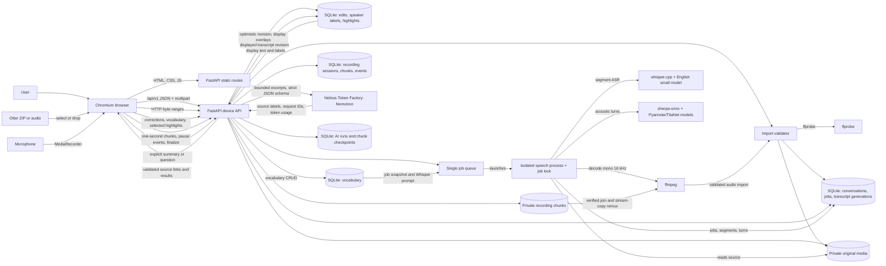

# Current architecture (development)

Last updated: 2026-10-16, ticket #15. This page describes the running development code on the #15 branch. Proposed components are in [ADR 0003](decisions/0003-cross-client-architecture.md) and are not drawn below.

The browser client shown here is the running development product and primary acceptance surface. Flutter is required for the native iOS app and the shared iOS/Android/desktop stretch in ticket #25; it is not yet part of the running architecture. Flutter web is optional.

## Runtime and ownership

| Component | Current implementation | Owns |
| --- | --- | --- |
| Browser UI | Plain HTML, CSS, and JavaScript in `src/stellis/static/` | File selection/drop, microphone permission and MediaRecorder capture, chunk upload/recovery, conversation list, fixed player with scrub/seek, automatic processing request, job status, selectable transcript, segment tracking, highlight filter, text and speaker editors, vocabulary panel, summary and question controls with linked evidence. |
| Device service | FastAPI in `src/stellis/server.py`, started by `uv run stellis serve` | Loopback HTTP (`127.0.0.1:8765`), API routes, static UI, audio range responses, worker startup. |
| Importer | `src/stellis/importer.py` | Bounded multipart/ZIP extraction, SHA-256 deduplication, `ffprobe` duration/stream validation. |
| Recorder | `src/stellis/recording.py` | Private bounded chunk files with fsync/digest, interrupted-session listing, pause/device events, verified join, ffmpeg stream-copy remux, import handoff, explicit discard. |
| Storage | `src/stellis/storage.py` | SQLite conversations, jobs, current transcript, immutable model generations, optimistic text/speaker corrections and events, anchored highlights, vocabulary, AI runs and chunk checkpoints; private original media under `~/Library/Application Support/Stellis` or `STELLIS_DATA_DIR`. |
| Speech worker | `src/stellis/processing.py` and `src/stellis/worker.py` | One queue, isolated child process with per-job file lock, restart requeue, ffmpeg decode, whisper.cpp segment ASR with a vocabulary snapshot prompt, sherpa-onnx acoustic turns, overlap alignment, aggregate metrics. |
| Model distribution | `scripts/setup_models.sh` | Downloads pinned model files to private local storage and verifies SHA-256; models do not enter Git. |
| AI adapter | `src/stellis/ai.py` | Explicit Nebius Nemotron calls, bounded chunk extraction and synthesis, lexical question evidence, strict schema and source-ID validation, persisted result and failure metadata. |
| Hosted service | Nebius Token Factory | Receives bounded displayed transcript excerpts and speaker labels only when the user starts an AI run; returns generated JSON, provider IDs, and usage. It does not receive audio. |

## Implemented connections

- `GET /` and `GET /conversation/{id}` serve the same browser shell.
- `/api/v1/health`, `/api/v1/conversations`, `/api/v1/conversations/import`, `/api/v1/conversations/{id}`, and `/api/v1/conversations/{id}/audio` provide import and replay. Legacy `/api` aliases remain.
- `/api/v1/capabilities` reports actual local English ASR and diarization readiness. `POST /api/v1/conversations/{id}/processing-jobs` starts or returns an idempotent job. `GET /api/v1/conversations/{id}/processing-job` and `/api/v1/jobs/{id}` support browser reload and polling.
- `GET /api/v1/conversations/{id}/transcript` overlays reversible word edits, segment/cluster speaker labels, and selected highlights on the current model generation. `PATCH /transcript/segments/{segment_id}` and `PUT /speakers/label` require the current revision. `GET /transcript/generations` and `GET /transcript/generations/{version}` expose retained machine output.
- `GET/POST /api/v1/vocabulary` and `PATCH/DELETE /api/v1/vocabulary/{term_id}` manage local terms. A job snapshots them and uses a bounded Whisper initial prompt. `POST /api/v1/conversations/{id}/highlights` anchors selected character offsets and quote; `DELETE /highlights/{highlight_id}` removes one.
- `GET/POST /api/v1/recordings` expose unfinished sessions and create one after microphone permission. `PUT /recordings/{id}/chunks/{sequence}` persists raw MediaRecorder chunks. `POST /recordings/{id}/events` stores pause/resume/device-ended events. `POST /recordings/{id}/finalize` remuxes and imports. `DELETE /recordings/{id}` discards an unfinished session.
- `POST /api/v1/conversations/{id}/ai-runs` starts or retries an idempotent summary or answer for the current displayed revision. `GET /api/v1/conversations/{id}/ai-runs` and `GET /api/v1/ai-runs/{run_id}` list and poll runs. The browser shows stages, failures, stale results, model and token metadata, and evidence links that seek into audio. Summary chunk checkpoints survive a failed synthesis.
- Browser text is selectable. Clicking without a selection seeks the segment; dragging within a segment opens Highlight/Copy. Native player scrubbing marks the active segment and the player remains visible while scrolling. Word timestamps are absent.
- Imported Otter ZIPs contribute only the audio member. Their transcript and summary are private reference files and are not ingested as model output.

## Current boundaries and gaps

The service is loopback-only and has no login, per-user authorization, hosted sync, encryption, or confirmed speaker identity. Browser microphone capture is implemented; native/mobile capture is not. Manual display labels do not improve the acoustic model. Selection is within one segment; precise word seeking awaits measured alignment (#39), and readable same-speaker turns await #38. AI citation validation checks segment identity, not factual truth; broad questions can conflate similarly named events, so generated claims need review against linked audio. Lexical answer retrieval can miss relevant passages. The original audio, recording chunks, and database use owner-only file permissions. `.env`, `data/`, `.private/`, and generated local state are excluded from Git. The current speech model is English-only and requires native binaries/models on the device. Versioned cross-client contracts for planned resources are in [`contracts/v1.md`](../contracts/v1.md); planned endpoints must not be treated as implemented.

## Verification snapshot

The supplied 57:49 Otter ZIP imported through Chromium; its audio loaded, sought 10 seconds, and reopened after reload. Twenty API/integration tests cover import, processing, corrections, highlights, recoverable recording, and AI validation. Browser checks on the real 789-segment interview covered text edit/restore, cluster label/clear, vocabulary CRUD, highlight/filter/removal, scrub-to-active segment, persistent player, the Nebius summary and question views, and evidence seek. Chromium used the available microphone for start/pause/resume/stop/save; a browser-recorded spoken sample produced five on-device segments and one acoustic group in 2.43 seconds. A tab closed before Stop left saved chunks listed on reopening; the user-facing recovery imported them. Permission denial and simulated storage failure produced visible states. The real interview pipeline completed in 515 seconds; its 19 initial acoustic groups and 53.7% confident assignment require #29; see the [aggregate validation record](validation/real-interview-speech.md). The interview summary used 12 checkpointed Nebius chunk analyses, retained one chronological point per chunk, and grouped six topics; a specific launch question returned a cited answer in the browser. A broad launch question conflated two launch references, which remains a known reliability limit.
