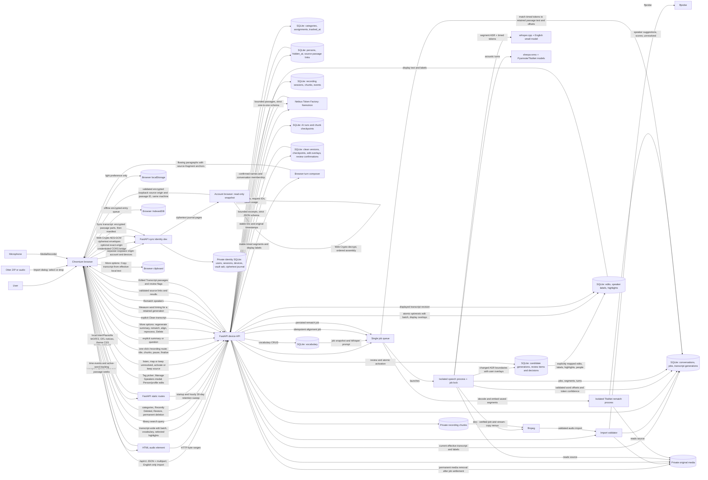

# Current architecture (development)

Last updated: 2026-10-16, through tickets #90–#91. This page describes the running development code. Proposed components are in [ADR 0003](decisions/0003-cross-client-architecture.md) and are not drawn below.

The browser client shown here is the running development product and primary acceptance surface. Flutter is required for the native iOS app and the shared iOS/Android/desktop stretch in ticket #25; it is not yet part of the running architecture. Flutter web is optional.

## Runtime and ownership

| Component | Current implementation | Owns |
| --- | --- | --- |
| Browser UI | Plain HTML, CSS, and JavaScript in `src/stellis/static/`; local Inter/Piazzolla WOFF2 assets, OFL notices, and `theme.css` are served by FastAPI without a build step | Dark-default cosmos theme, light preference in browser localStorage, optional login page and logout control, semantic colors and reduced-motion styling; category creation, assignment, filtering, and Recently Deleted/Restore/permanent-delete controls with visible 30-day expiry; concise labels and a top-right three-dot More options menu for Copy transcript, regeneration, rematch, alignment, reprocessing, Sync transcript, and Delete; one compact Search speakers/Tag/Untag picker on named and unnamed transcript headings, with a separate searchable Manage Speakers modal for Person rename, hide/show, and explicit merge target, local manual-name promotion, and a secondary detailed passage editor; Person panel and profiles with explicit passage/group confirmation, rename, merge, separation, and removal; generation-review panel with before/after wording, source/target audio, per-overlay mapping or unresolved choices, and source/new generation decision; library search results and local in-conversation phrase/speaker navigation; a centered Import dialog with file selection/drop, supported formats, and English-only language choice; one-click `/recording` workspace with editable title, transcript and AI availability areas, actual microphone source, fixed Pause/Resume/Stop bar, MediaRecorder capture, chunk upload/recovery, conversation list, fixed player with transcript-derived speech intervals, scrubbing, five-second transport, eight speed choices, and keyboard seek, automatic processing request, job status, selectable transcript with view-only speaker-turn grouping, per-fragment and measured word seeking with playback tracking, highlight filter, transcript-wide Edit/Done mode with in-place passage editing and atomic save in both source and Edited Transcript tabs, contextual speaker editing, vocabulary panel, speaker rematch and change filter, summary and question controls with linked evidence. |
| Sync identity dev | `src/stellis/sync_server.py`, `src/stellis/sync_identity.py`, `src/stellis/sync_static/`, and shared browser modules in `src/stellis/shared/`, started by `uv run stellis sync-serve` | Separate loopback origin (`127.0.0.1:8769` by default), account shell with read-only decrypted text snapshots, independent multi-user credentials and seven-day sessions, account-owned device metadata, public vault salt/check ciphertext, bounded opaque text journal, optional exact-loopback-origin credentialed CORS, own private SQLite directory. No conversation, media, or plaintext-content routes. |
| Device service | FastAPI in `src/stellis/server.py`, started by `uv run stellis serve` | Loopback HTTP (`127.0.0.1:8765`), API routes, static UI, audio range responses, optional single-account session middleware, worker startup, startup and hourly Recently Deleted retention sweep. |
| Local auth | `src/stellis/auth.py` | Opt-in one-account verifier and seven-day hashed-token sessions in a separate private SQLite file; protected browser and API routes, with public health/login/static resources. |
| Importer | `src/stellis/importer.py` | Bounded multipart/ZIP extraction, SHA-256 deduplication, `ffprobe` duration/stream validation. |
| Recorder | `src/stellis/recording.py` | Private bounded chunk files with fsync/digest, interrupted-session listing and title updates, pause/device events, verified join, ffmpeg stream-copy remux, import handoff, explicit discard. |
| Storage | `src/stellis/storage.py`, `src/stellis/library.py`, `src/stellis/people.py`, and `src/stellis/generation_review.py` | SQLite conversations, local category assignments, reversible `trashed_at`, ordered permanent deletion and startup staged-media recovery; confirmed Person identities and source passage links; jobs, current transcript, immutable model generations, pending ASR candidate reviews and durable mapping history, optimistic single and batch text corrections, speaker labels and events, anchored highlights, vocabulary, AI runs and chunk checkpoints, clean versions, clean edits and review confirmations; private original media under `~/Library/Application Support/Stellis` or `STELLIS_DATA_DIR`. |
| Speech worker | `src/stellis/processing.py`, `src/stellis/rematch.py`, and `src/stellis/worker.py` | One queue, isolated child process with per-job file lock, restart requeue, ffmpeg decode, whisper.cpp segment ASR with a vocabulary snapshot prompt and validated native token timing grouped into words, source-preserving alignment of retained passages, sherpa-onnx acoustic turns, overlap alignment, TitaNet segment embeddings and conservative speaker rematch, aggregate metrics. |
| Model distribution | `scripts/setup_models.sh` | Downloads pinned model files to private local storage and verifies SHA-256; models do not enter Git. |
| AI adapter | `src/stellis/ai.py` | Explicit Nebius Nemotron calls, bounded chunk extraction and synthesis, lexical question evidence, strict schema and source-ID validation, persisted result and failure metadata; explicit summary regeneration creates a fresh run for the current revision unless one is active; `src/stellis/clean.py` validates one-to-one clean passages, preserves source timing, flags suspect single-letter hyphen terms for audio review, and saves separate clean versions and user wording overlays. |
| Local search | `src/stellis/search.py` | On-demand scan of current displayed transcript text, titles, speaker labels, and confirmed Person names; bounded result delivery with total count. Search is not sent to Nebius. |
| Hosted service | Nebius Token Factory | Receives bounded displayed transcript excerpts and speaker labels only when the user starts an AI run; returns generated JSON, provider IDs, and usage. It does not receive audio. |

## Implemented connections

- If `STELLIS_DEVICE_ORIGIN` names one exact loopback origin with a port, the sync identity service allows credentialed `/sync/v1` CORS reads and writes from that origin after the browser signs in at the sync origin. Foreign origins fail preflight or state-changing requests. With `STELLIS_SYNC_ORIGIN` set to that separate loopback service, `GET /api/v1/sync-config` exposes the account origin to the authenticated device page. The conversation More options menu then offers Sync transcript: the device browser verifies the vault passphrase, encrypts effective transcript passages in bounded parts, and posts a final encrypted manifest containing its source origin. The account browser decrypts complete snapshots into a read-only text view. It builds source links only from an exact encrypted loopback origin with a port; malformed or external origins become plain timestamps. Older snapshots without an origin use the original default port 8765. No audio crosses this bridge. [ADR 0023](decisions/0023-encrypted-conversation-snapshots.md) records the format, completion rule, and limits; [ADR 0022](decisions/0022-loopback-browser-sync-bridge.md) records the production browser-permission and cross-site session limits.

- `stellis sync-serve` starts a separate development identity origin. `POST /sync/v1/auth/register|login|logout`, `GET /sync/v1/me`, `POST /sync/v1/sessions/revoke-all`, and `GET/POST/DELETE /sync/v1/devices` manage development accounts, sessions, and account-owned device names/IDs. Its browser shell works without a local speech worker. `GET/POST /sync/v1/vault` and `GET/POST /sync/v1/entries` store a public salt, encrypted vault check, and account-owned append-only text envelopes. The browser derives a nonextractable AES-GCM key from a separate vault passphrase, authenticates routing IDs, and queues encrypted entries in IndexedDB offline. It exposes no `/api/v1` device resources or plaintext content. [ADR 0021](decisions/0021-browser-encrypted-text-journal.md) records the prototype and threat limits. [ADR 0020](decisions/0020-separate-sync-identity-origin.md) records the separation.

- With `STELLIS_AUTH_MODE=required`, `/auth` provides first registration or login. `GET /api/v1/auth/status`, `POST /register`, `POST /login`, and `POST /logout` manage an HttpOnly, SameSite Strict cookie. Every workspace page and data API, including media, jobs, transcript, recording, and AI routes, requires the session; health and static assets remain public. Cross-origin state changes fail. [ADR 0019](decisions/0019-opt-in-local-login.md) records the one-account scope.

- `GET /` and `GET /conversation/{id}` serve the same browser shell.
- `GET /api/v1/search?q=…&category_id=…` searches active titles, displayed passage wording, speaker names, and confirmed Person names locally with an optional category or Uncategorized filter. The browser shows up to 150 results and links each passage or speaker hit to its stable segment ID; Person hits open a profile. Direct passage links resolve the ID against the active transcript, seek the original audio, and leave playback paused. In-conversation search uses the loaded segments for phrase and speaker filtering, match counts, and next/previous navigation. Trashed conversations are absent from subsequent search responses.
- `GET/POST /api/v1/persons`, `GET/PATCH/DELETE /persons/{id}`, `PATCH /persons/{id}/visibility`, `POST /persons/{id}/merge`, and the conversation-level Person-link routes provide explicit confirmation of a current passage or acoustic group, profile history, rename, hide/show from tag suggestions, merge, separation, and unlinking. The browser's compact picker can submit an existing `person_id` or a new `name` to `PUT /conversations/{id}/person-links`; a new Person and its passage links are created in one SQLite transaction. Group tagging retains passages already confirmed as a different person and returns their count, while retagging a selected confirmed person can update that person's passages in the group. Hidden People keep their confirmed labels and links; the current linked Person remains visible in the picker for Untag. Manual local names stay separate until the user tags them as People. Confirmed Person names override display labels for linked passage IDs. Profiles hide trashed conversations; permanent deletion removes their links and leaves shared Person records. Rematch retains links through stable passage IDs. Reprocessing with new passage IDs leaves historical links visible in the profile without assigning the new passages an identity. [ADR 0016](decisions/0016-confirmed-person-links.md) records the identity boundary; [ADR 0025](decisions/0025-speaker-management-visibility.md) records the modal and visibility rule.
- `GET/POST /api/v1/categories`, `PATCH/DELETE /categories/{id}`, and `PUT/DELETE /conversations/{id}/categories/{category_id}` manage many-to-many local assignments. `POST /conversations/{id}/trash` moves a conversation to the browser's Recently Deleted stage and hides it immediately while preserving its data; `GET /trash` returns `trashed_at` and `expires_at`, and `POST /trash/{id}/restore` clears the retention clock. `DELETE /trash/{id}` waits for all speech/AI/cleanup jobs to settle, then transactionally removes dependent records and deletes private media. A device startup/hourly sweep uses the same path for items older than 30 days, rechecking expiry inside the transaction and retrying busy items. Startup recovery reconciles staged media after an interrupted delete. [ADR 0015](decisions/0015-local-categories-and-trash.md) records the retention, deletion, and future sync-tombstone decisions.
- `/api/v1/health`, `/api/v1/conversations`, `/api/v1/conversations/import`, `/api/v1/conversations/{id}`, and `/api/v1/conversations/{id}/audio` provide import and replay. Legacy `/api` aliases remain.
- `/api/v1/capabilities` reports actual local English ASR and diarization readiness. `POST /api/v1/conversations/{id}/processing-jobs` starts or returns an idempotent job. `GET /api/v1/conversations/{id}/processing-job` and `/api/v1/jobs/{id}` support browser reload and polling.
- `GET /api/v1/conversations/{id}/transcript` overlays reversible word edits, segment/cluster speaker labels, and selected highlights on the current model generation. The browser enters one transcript-wide Edit/Done mode, keeps changes pending locally, and sends changed passages through `PATCH /transcript/segments` for one atomic revision. Failed or conflicting saves retain pending wording and navigation with pending changes warns the user. `PATCH /transcript/segments/{segment_id}` and `PUT /speakers/label` require the current revision. `GET /transcript/generations` and `GET /transcript/generations/{version}` expose retained machine output.
- `GET/POST /api/v1/vocabulary` and `PATCH/DELETE /api/v1/vocabulary/{term_id}` manage local terms. A job snapshots them and uses a bounded Whisper initial prompt. `POST /api/v1/conversations/{id}/highlights` anchors selected character offsets and quote; `DELETE /highlights/{highlight_id}` removes one.
- `GET/POST /api/v1/recordings` expose unfinished sessions and create one after microphone permission. `PUT /recordings/{id}/chunks/{sequence}` persists raw MediaRecorder chunks. `PATCH /recordings/{id}` saves its title; `POST /recordings/{id}/events` stores pause/resume/device-ended events. `POST /recordings/{id}/finalize` remuxes and imports. `DELETE /recordings/{id}` discards an unfinished session.
- `POST /api/v1/conversations/{id}/ai-runs` starts or retries an idempotent summary or answer for the current displayed revision. A summary request with `force: true` creates a new run even after success, but reuses a queued or running run for that revision. `GET /api/v1/conversations/{id}/ai-runs` and `GET /api/v1/ai-runs/{run_id}` list and poll runs. The browser shows stages, failures, stale results, model and token metadata, and evidence links that seek into audio. Summary chunk checkpoints survive a failed synthesis.
- `POST /api/v1/conversations/{id}/clean-runs` starts or retries an explicit Nemotron cleanup for the displayed transcript revision. `GET /conversations/{id}/clean-runs` and `GET /clean-runs/{run_id}` list and poll versions. `PATCH /clean-runs/{run_id}/segments` atomically saves changed wording from one global Edit/Done session; the single-passage route remains available. `PUT /clean-runs/{run_id}/segments/{segment_id}/review` records audio-review confirmation. Every cleaned passage retains its original ID, text, timing, and speaker; the third browser tab composes readable turns, opens on generation, and seeks audio on passage click. The Compare panel exposes source and edited wording, source playback, copy, and restore actions. Suspect model changes, including unsafe deletions, fall back to narrow filler cleanup or exact source wording and are marked for review. Earlier clean versions are checked with the current safety and recognition-artifact rules before browser display.
- `POST /api/v1/conversations/{id}/word-alignment` starts or returns an idempotent job for a retained transcript generation. It reuses a saved timed generation when available or measures the original audio on the device, then matches identical words by text and nearby time into the selected source passages. The new generation preserves source IDs, text, speakers, and segment timing, so user overlays remain attached. The browser offers **Measure word timing** when the current transcript has no timed words.
- A full speech job that changes passage IDs carrying edits, labels, highlights, or Person links saves a candidate generation and leaves the old displayed transcript active. `GET /conversations/{id}/transcript/review` returns source evidence and candidate passages; `PUT /review/decisions` stores explicit target passage or unresolved choices; `POST /review/activate` atomically moves only approved overlays and activates the candidate, while `POST /review/keep-source` leaves the current generation active. `GET /review/history` exposes source/target versions and durable decisions for other clients. The browser provides source and target playback and keeps unresolved old-generation evidence visible after acceptance. [ADR 0017](decisions/0017-asr-generation-review.md) records why no boundary mapping applies automatically.
- `POST /api/v1/conversations/{id}/speaker-rematch` starts or returns an idempotent device job against the saved machine generation. It reuses transcript segments and acoustic turns, adds TitaNet speaker suggestions or unresolved state, and saves a new generation without changing segment IDs or user overlays. The browser shows dense speaker names, unresolved count, and a filter for changed suggestions.
- The browser groups consecutive resolved fragments from the same displayed speaker when the gap is at most 1.5 seconds. The group is a flowing paragraph with a transcript-wide Edit/Done state; original fragment IDs, timestamps, edits, speaker controls, highlights, and source links stay attached to each part. No grouped record is stored by the service.
- Browser text is selectable. Clicking without a selection seeks a measured word when available or the segment start otherwise; dragging within a segment opens Highlight/Copy. The fixed custom controls use the same HTML audio element and HTTP byte-range route: a range slider scrubs, keyboard arrows move ten seconds, adjacent buttons move five seconds, and a speed menu sets `playbackRate`. Current transcript intervals draw display-only track segments; audio time events mark the active passage and word. The player remains visible while scrolling. Manual word edits hide the source word offsets for that passage until re-aligned. [ADR 0026](decisions/0026-browser-player-controls.md) records the control split and limits.
- Imported Otter ZIPs contribute only the audio member. Their transcript and summary are private reference files and are not ingested as model output.

## Current boundaries and gaps

Both development services are loopback-only. The optional device login guards one local data directory; the separate identity service has multi-user account and device metadata, an encrypted text-note journal, and read-only encrypted conversation text snapshots. It has no audio sync, edit replay, remote deployment, recovery, rollback protection, or production E2EE claim. Snapshot source links work only on the recording machine while its local service is reachable; the encrypted source origin does not locate another device. An interrupted upload leaves ignored orphan ciphertext parts. Browser microphone capture is implemented in a fixed recording workspace; its transcript and AI areas are unavailable until post-stop local processing. Genuine provisional live on-device ASR, notes, and agent chat during capture remain #86. Native/mobile capture is not. Manual display labels and Person confirmations do not improve the acoustic model. Speaker rematch scores are uncalibrated and may leave short voices unresolved; its five major groups in the real sample are suggestions, not identities. Confirmed Person links are explicit user actions on passages, and a new ASR generation with new IDs requires an explicit review decision before a link can move. Generation review does not split corrected wording across multiple target passages; unresolved changes remain attached to the old generation. Highlights remain anchored within one source segment; native Whisper token timing may be approximate, especially at clipped boundaries. Speaker turns are a browser readability rule, and a provisional assignment can group passages incorrectly until rematched or corrected. Clean-transcript lexical checks cannot guarantee quotation accuracy; unusual technical terms now receive a review flag, and direct audio review remains necessary. AI citation validation checks segment identity, not factual truth; broad questions can conflate similarly named events, so generated claims need review against linked audio. Lexical answer retrieval can miss relevant passages. Permanent deletion waits for queued or running jobs. The original audio, recording chunks, and database use owner-only file permissions. `.env`, `data/`, `.private/`, and generated local state are excluded from Git. The current speech model is English-only and requires native binaries/models on the device. Versioned cross-client contracts for planned resources are in [`contracts/v1.md`](../contracts/v1.md); planned endpoints must not be treated as implemented.

## Verification snapshot

The supplied 57:49 Otter ZIP imported through Chromium; its audio loaded, sought 10 seconds, and reopened after reload. Thirty-four API/integration tests cover import, processing, corrections, highlights, recoverable recording, AI validation, and speaker rematch preservation. Browser checks on the real 789-segment interview covered text edit/restore, cluster label/clear, vocabulary CRUD, highlight/filter/removal, scrub-to-active segment, persistent player, the Nebius summary and question views, evidence seek, rematch completion/reload, change filtering, and mobile layout. The transcript now renders 285 speaker turns from 789 fragments; browser checks covered a second-fragment seek, transcript-wide editing of three distant passages in one save/reload, restoration in a second edit session, a manual-label split and rejoin, highlight selection/removal, AI source seek, and desktop/mobile read and edit views. Chromium used the available microphone for start/pause/resume/stop/save; a browser-recorded spoken sample produced five on-device segments and one acoustic group in 2.43 seconds. A tab closed before Stop left saved chunks listed on reopening; the user-facing recovery imported them. Permission denial and simulated storage failure produced visible states. The real interview pipeline completed in 515 seconds with 19 initial acoustic clusters and 53.7% confident assignment. Rematch produced five supported groups, 681 suggestions (86.3%), and 108 unresolved segments; see the [aggregate validation record](validation/real-interview-speech.md). The interview summary used 12 checkpointed Nebius chunk analyses, retained one chronological point per chunk, and grouped six topics; a specific launch question returned a cited answer in the browser. A broad launch question conflated two launch references, which remains a known reliability limit.

The full 789-passage interview completed a real conservative-clean-v2 Nemotron run in 52 provider attempts. Its stored v2 result changed 157 passages and initially flagged 82 for audio review; a later conservative audit found 10 passages needing source fallback and 12 additional review flags. The browser now applies this safety check to earlier versions before display. Chromium checks covered a later passage seek, two distant clean edits in one save and reload, source comparison, review confirmation, and 390-pixel width without overflow. Independent Otter reference text exists but has its own recognition errors; quote fidelity still requires listening at uncertain passages.

A fresh conservative-clean-v3 run on the same 789-passage interview succeeded in 54 Nebius attempts. It changed 154 passages, flagged 108 for audio review, and remained current for source revision 26. A second validation pass found no unflagged substantive deletions; six short passages contained only safe filler deletion yet crossed the conservative overlap threshold if checked in isolation. This is a structural guard check, not an audio-fidelity result.

The versioned native-word pipeline produced 29 timed words on a 10.8-second browser-recorded sample. A source-preserving alignment job attached 7,612 measured words to the original 789 interview passages while retaining all 789 IDs, texts, speaker assignments, and segment times. Twelve passages remained untimed. Five comparison windows showed 0.16–0.25-second median absolute difference from independently timed Otter words; see [aggregate timing validation](validation/real-interview-word-timing.md). Chromium checks covered clicking a word at 500.04 seconds, scrub-to-active-word tracking, selection/highlight/removal across word spans, the fixed player, and 390-pixel layout. A second 50-second browser conversation ran Measure word timing through the UI, produced 122 timed words, and retained them after completion.

The cosmos theme was checked in Chromium at 1440 and 390 pixels across home, transcript, Edited Transcript, AI, and light mobile states. Theme persistence, locally served fonts, import/record entry, vocabulary, transcript Edit/Done, speaker editor, tabs, audio seeking, reduced motion, and mobile width passed. All browser resource requests stayed on the loopback origin. Text, muted/status, and accent control color pairs measured above 4.5:1 in both themes; [ADR 0013](decisions/0013-cosmos-browser-theme.md) records the measured ratios and design choice.

Local library search over the real interview returned a 12-hit CubeSat query in about 37 ms. Chromium opened a passage result at 2:13 with audio paused, moved through phrase matches, combined a speaker filter, and cleared search without changing the current playback time. At 390 pixels the search controls did not overflow. A second browser conversation was given a temporary manual speaker name, found from library search, and cleared; the old result disappeared. Search results are computed on request and now omit trashed or permanently deleted conversations.

Forty tests cover category assignments, import deduplication, search filtering, Recently Deleted/Restore, dependent-record deletion, pending-job blocking, staged-media recovery, and 30-day automatic retention with busy-job retry and Restore clock reset. Chromium created two categories on the real interview, assigned both, filtered search, renamed one, reloaded, removed a category without losing the conversation, and restored the interview with its transcript and remaining category intact. A 50-second browser recording was hidden during playback then restored with transcript intact. Disposable browser imports were permanently deleted after processing settled; their media, conversation, and jobs were absent afterward. The mobile category layout had no horizontal overflow. Chromium also showed the Recently Deleted label and exact local expiry on a disposable import; after aging that item past 30 days, restarting the device service removed its database row and media automatically.

Chromium confirmed a Person across the supplied interview and another recording, opened its profile from the transcript and local search, sought the linked audio while paused, and exercised rename, merge, separation, removal, and 390-pixel layout. A disposable browser import went through confirmation, Recently Deleted, and permanent deletion; its profile membership and conversation record were removed while the Person record stayed available for explicit empty-profile deletion.

Forty-five tests include synthetic ASR split/merge review of a text correction, manual speaker label, highlight, and confirmed Person; they verify explicit decisions, candidate retention, atomic activation, invalid quote rejection, unresolved source anchors, durable mapping history, summary regeneration, and active-run reuse. Chromium loaded a pending review on a 10-second fixture, played through the same browser shell, saved one unresolved and one mapped decision, reloaded, activated the candidate, and reloaded again with the unresolved item still visible. A full on-device reprocess of the supplied 57:49 interview staged two opening-boundary changes while retaining the 789-passage source transcript at revision 28. Chromium played the source, mapped the text correction and highlight to the 0:00 candidate, reloaded to confirm saved choices, and activated the new generation. The active passage shows the user correction and highlight, a later confirmed Person still labels their stable passage, the decision is in review history, and the completed panel is hidden. The 390-pixel layout has no horizontal overflow. This checks preservation of these edits, not transcription or speaker accuracy across the full recording.

Forty-one tests pass, including forced summary regeneration and active-run reuse. Chromium checked the real interview's three-dot menu at desktop and 390-pixel widths, Escape and canceled Delete, and the `force: true` request without a provider call. A disposable browser import went through Delete from the menu, Recently Deleted, Restore, then permanent deletion; the conversation endpoint returned 404. Neither layout overflowed. [ADR 0018](decisions/0018-conversation-actions-menu.md) records the menu and copy choices.

Forty-seven tests pass with local login registration, logout, forged and expired session, origin rejection, and protected import/audio/AI routes. Chromium on a separate data directory registered an account, reloaded the workspace, logged out, observed 401 responses for conversation and audio routes, logged in again, and fit the 390-pixel viewport. The default open local mode remains covered by the existing suite.

Forty-eight tests pass, including a recognition-artifact check for an unusual single-letter hyphen word and its application to an earlier stored clean run. Chromium showed the Review badge and 0:40 audio link on the real interview's stored v3 Edited Transcript at 390 pixels. A private comparison with the independent Otter export raised the concern but cannot establish the exact spoken word; #48 remains open for direct listening and broader quote checks.

Fifty tests pass with two-account sync-identity isolation, device ownership and cross-account 404, login/logout, forged and expired sessions, all-session revocation, Origin rejection, and absence of device content routes. Two isolated Chromium profiles registered on the separate origin; Alice's device list stayed private from Bob, logout returned 401, and the origin returned 404 for a device-service conversation route. The account shell fit a 390-pixel viewport. No ciphertext sync or production OIDC was exercised.

At the #73 checkpoint, fifty-one tests passed with ciphertext journal size/IV checks, immutable per-account salt, idempotent entry IDs, cursor pagination, and cross-account isolation. Two Chromium profiles on one account encrypted and decrypted the same note, then converged after one created another while offline. A wrong vault passphrase failed at unlock; a modified stored ciphertext failed AES-GCM authentication. Captured POST bodies and raw SQLite bytes contained no sample note or vault passphrase. The separate account page fit 390 pixels.

At the #75 checkpoint, fifty-two tests passed with exact-origin credentialed preflight and mutation, denial of another loopback origin, and rejection of an external-origin configuration. Chromium signed in on the sync origin at port 8769, then from the device origin at port 8765 read account/vault metadata and created and removed a temporary device through credentialed CORS. A fresh profile received 401, and a page from port 8770 could not read a sync response. The network trace included OPTIONS preflights.

Fifty-three Python tests and the shared snapshot-format checks pass. Chromium sent the supplied 57:49 interview as 79 encrypted journal entries and opened its 777-passage read-only text snapshot in a second browser profile; the 390-pixel account view did not overflow. Captured request bodies and the sync SQLite file contained no sampled title or passage phrase in plaintext. A forced failure before the final manifest left the partial snapshot hidden; a reload and retry showed one complete snapshot. Fresh-session and wrong-passphrase browser states were checked. This verifies a one-way development text snapshot, not full encrypted conversation sync.

The real interview's 777 effective passages copied from the More options menu as 277 speaker paragraphs with timestamps (54,921 characters). Chromium confirmed the first and last current passage wording and first speaker label in the clipboard, a closed menu, no hosted AI request, and no horizontal overflow at 390 pixels. Clipboard access can fail when browser permission is denied; the UI reports that failure.

On a second device service at port 8771, Chromium synced a five-passage recording to a separate account origin and rendered passage links back to port 8771. The sync SQLite file had no sampled source origin, title, or passage text. Shared format checks reject malformed and non-loopback origins and preserve default-port links for older snapshots.

At #83, the signed-in Otter speaker picker and Manage Speakers modal were inspected alongside all three supplied screenshots; [the reference ledger](otter-ui-reference.md) records later selection, import, and recording observations separately from implementation choices. In Stellis Chromium on the real interview, both Speaker 2 and confirmed Shereen opened the same compact picker without entering transcript Edit mode; 390-pixel layout had no horizontal overflow. A disposable browser fixture tagged an unnamed acoustic group, retagged its named result, and retained a different confirmed Person passage with a visible one-passage notice. Nine editing tests, five library tests, and four generation-review tests passed at that checkpoint.

At #85, the Otter Manage Speakers rename field and separate hide/merge controls were observed without changing the user's account. Stellis Chromium opened its modal from Speaker 2 on the real interview and displayed both confirmed Shereen and local Jay; Edit transcript stayed off and the 390-pixel modal did not overflow. A disposable two-Person browser fixture renamed Ava, hid and restored Bea, selected a merge target, merged them, and showed one Person name across both passages. Ten editing tests and five library tests pass. Speaker identity changes do not yet invalidate existing AI results; #93 tracks that dependency.

At #89, the live Otter speed menu and player transport were inspected. On the Stellis real interview, Chromium verified a 2:00 slider seek, five-second forward/back, a 1.5x speed change, a ten-second focused-slider ArrowRight, timed-word click at 60.13 seconds followed by Pause, transcript-derived interval marks, and no overflow at 390 pixels in dark and light themes. Skip Silence is outside the current player and tracked in #95.

At #90, Chromium verified one-click microphone start, desktop and 390-pixel recording layouts, Pause/Resume, an edited title and actual microphone source, Stop, saved local ASR and replay, plus reload recovery from ten saved chunks into a transcript-bearing conversation. Two disposable recordings and one empty interrupted session were removed. The recording title persistence and finalized-state rejection are covered by `tests.test_recording`. [ADR 0027](decisions/0027-recording-workspace-and-transcript-boundary.md) records the one-click route and the boundary between live capture and finalized local ASR.
