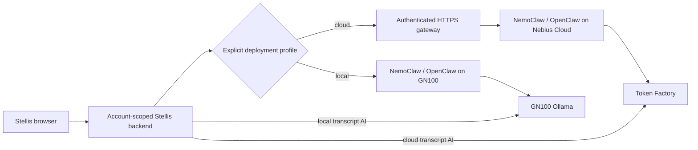

# 0062: Separate local and cloud agent deployments

Status: accepted by the owner, 2026-10-20; cloud provisioning pending.

The owner initially required a cloud-only agent runtime, then explicitly requested two versions while creating a Nebius Cloud project. Preserve both requirements as distinct profiles, not an automatic fallback chain.

`cloud` uses authenticated HTTPS to OpenClaw inside NemoClaw on Nebius Cloud, with Token Factory inference. `local` keeps the GN100 NemoClaw/OpenShell architecture and uses Ollama inference on GN100. Both use the same Stellis agent records, editable instructions, notebook scoping and citation validation. The Mac is not an execution or inference host.

Use separate data roots and credentials. The local test gateway uses port 8990 so the existing port-8080 route is untouched. Cloud configuration fails closed; no local subprocess or inference fallback is allowed. Local inference uses only a loopback endpoint and never receives a saved Nebius key. Settings displays the selected version.

Unset configuration preserves the existing installation during migration, explicitly labeled as GN100 execution with Token Factory inference. New deployments use the supplied explicit environment profiles. Cloud-side provider and MCP administration remain separate from client credential settings. Real cloud verification is an outstanding deployment gate, not something unit tests establish.

See [deployment instructions and evidence](../agent-deployments.md) and [#406](https://github.com/reversely/stellis-dev/issues/406).
