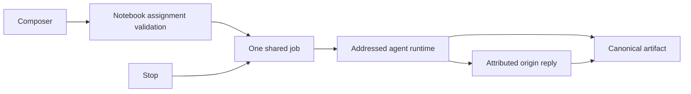

# 0075: Explicit notebook agent addressing

Status: accepted, 2026-10-20.

The wireframe permits addressing one assistant from another thread. Preserve that thread without copying independent drafts or starting two jobs.

A persisted agent_handoffs row links an originating agent, addressed agent, notebook and shared agent job. Both agents must be enabled and assigned to the notebook (the default Chief of Staff can reach the account's notebooks). Validation occurs before dispatch and before publication; an active watcher cancels requests when assignments change.

The addressed agent uses the existing managed runtime, instructions, notebook sources and trace route. The origin displays its attributed reply and projects its canonical artifact. A transaction publishes the origin reply, artifact-message link and final job state together. Stop from either thread targets the same request. Persisted draft recipients use stable IDs, not parsed display names.

Explicit addressing is not an automatic planner or an agent collaboration graph. The wireframe's separate source gathering, specialist checking and final drafting sequence remains to be implemented and verified.
