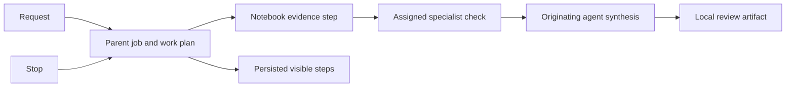

# 0076: Visible notebook agent coordination

Status: accepted, 2026-10-21.

Wireframe screens 1 and 5 require an outcome request to gather notebook evidence, obtain specialist checks and produce a reviewable artifact in the original thread. The older research delegation API requires web research credentials and an email recipient; those requirements do not apply to notebook-only work.

A notebook request with multiple enabled deployments runs a bounded planning turn through the configured managed agent route. The planner may request zero to three distinct supporting agents from the actual notebook assignments. Stable IDs, membership, task length and plan shape are validated. The global coordinator can originate work; it is not automatically inserted as a specialist into every notebook. Explicit @ requests retain their direct-dispatch behavior.

The parent agent job persists the request and ordered agent_work_steps. Each step stores the agent identity, task, state, child job, result and cited source references. Supporting turns use their own saved instructions and notebook policy, produce analysis rather than artifacts, and do not automatically search mail. Their completed findings and the original retrieved evidence feed the final originating-agent turn. The final draft uses the existing canonical review artifact and external-save controls.

Assignment checks precede each step and final publication. A watcher cancels active work when a participating deployment is disabled or removed. Parent Stop cancels the shared task, including its active child process; no subsequent steps run. Restart marks unfinished work interrupted and queued steps skipped. Resending deliberately creates a new request; completed steps are not silently replayed. Traces distinguish work planning, supporting review and final chat, and retain actual model/provider reports.

This sequence does not implement automatic follow-up task proposals, confirmed sending, a daily brief or native capture. These remain separate requirements in the full wireframe acceptance ledger. A plan selects at most three supporting agents; it is not an unbounded autonomous workflow.
