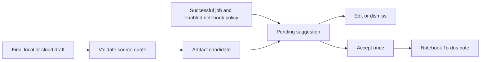

# 0077: Source-backed follow-up proposals

Status: accepted, 2026-10-21.

The wireframe ends delegated work with a draft and proposed task in its notebook. Reuse the existing suggestions model and its revisioned task writes rather than creating a second task approval path.

A final draft may include one optional follow_up object containing task text, a retrieved-source index and an exact quote. Validation checks the task text, index and quote against the selected excerpt. This validates the cited evidence identity, not the semantic correctness of every generated action; actual model output must still be reviewed. Missing evidence should produce a request to obtain it, not an instruction to invent it.

The candidate is stored under its canonical artifact in agent_followups. Successful job completion publishes it in the same database transaction as the succeeded state, including the explicit cross-agent handoff path. Failed or interrupted jobs cannot publish it. The notebook's task-suggestion policy is checked at publication. Supporting analysis turns do not create artifacts or follow-up proposals.

Publication reuses or creates the notebook's empty To-dos note, matching the existing manual task widget's destination. It adds a pending suggestion, not a task. A deterministic artifact-based suggestion ID and stored link make repeated completion idempotent. Existing Accept writes the task once, Edit preserves the original proposal and Dismiss creates no task. The draft and proposed task remain separately reviewable.

The original thread projects the canonical suggestion beside the artifact. Notebook Activity displays the same suggestion separately, avoiding a duplicate card within its artifact. Both surfaces use shared task review controls and retained editor drafts. Source links retain their trusted retrieval target and quoted snapshot. The notebook setting is labelled Suggest tasks because it governs meeting and agent-work proposals.
