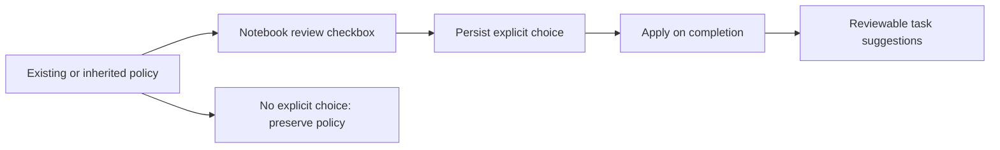

# 0078: Explicit task-suggestion choice during setup

Status: accepted, 2026-10-21.

Notebook review now offers Suggest tasks alongside agent selection for both starter and source-proposed notebooks. This enables pending suggestions only; the existing review actions still control task writes.

The durable setup state stores task_choices by proposal identity. An absent choice means preserve the notebook's existing or inherited policy. Status reports effective notebook and collection defaults for display without turning those defaults into writes. Explicit true/false choices become notebook On/Off at completion. Reopening setup clears old explicit choices so past setup decisions cannot silently overwrite later settings. Choices persist across Back, reload and source-review selection.

Completion checks conflicting explicit choices for repeated notebook names before creating any workspace objects. Only reviewed/selected notebooks receive changes. API booleans are strict and the service validates the bounded choice map. Existing clients that omit task_choices retain prior behavior.

