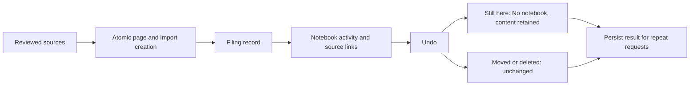

# 0079: Reversible source filing

Status: accepted, 2026-10-21.

Onboarding creates local source notes, import identities and one notebook filing record in a single SQLite transaction. The shared page creation helper accepts the caller's connection so source content, task indexing and the audit record commit or roll back together. Existing import identities remain authoritative; a retry neither duplicates nor silently refiles an undone source. Pre-existing imported notes are not retroactively attributed to a new filing.

Notebook Activity projects actual filing records and their current source links. Undo clears notebook membership only for active notes still in that notebook. It preserves all content, subsequent edits, external originals, moved notes and deleted notes. The result records detached and unchanged IDs and is returned unchanged on repeated requests. Notes remain accessible in No notebook. The activity explicitly explains this before Undo and displays the outcome afterward.

The undo route scopes the filing ID to its notebook and the existing account-scoped database. This is a deterministic filing operation, not a model inference. It does not implement the separate source Compare proposal shown on wireframe screen 4, nor recording auto-filing.

