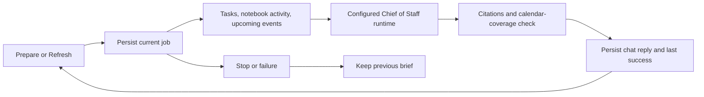

# 0080: Persisted Chief of Staff daily brief

Status: accepted, 2026-10-21.

Home exposes an explicit Prepare brief / Refresh action. It gathers current open tasks, notebook activity and connected calendar events for the next 24 hours, then asks the actual default agent through the configured runtime. The model receives at most twenty items per category, sorted by task due date, notebook review/work counts and event start. Task and activity excerpts are bounded; totals and timestamp are retained. This is a read-only synthesis, not a task acceptance or sending action.

The existing job and chat-message records own inference history and traces. A singleton daily_brief row points to the current job and last successful message/coverage. Refresh failures and Stop preserve the last success. Restart marks running jobs interrupted using the existing lifecycle; shutdown explicitly cancels and awaits brief tasks before account storage is removed. Concurrent starts are serialized by SQLite and reject a second active run.

The reply uses canonical citation rendering. Missing or partial calendar data is unknown, never a proven empty schedule. A narrow answer validator rejects common empty-calendar claims when coverage is incomplete; it feeds the existing bounded two-attempt retry. It does not constitute general semantic verification. A failed validation publishes no reply. Source links open tasks, notebook activity, and the calendar or connection settings.

The Chief of Staff leads the Everywhere agent group; Home places the brief and agent groups before search and setup/sample panels, matching the prototype's hierarchy without replacing richer styling. The brief remains explicitly user-triggered; it is not a scheduled background notification.

