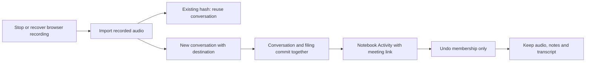

# 0081: Recording filing shares the notebook Undo ledger

Status: accepted, 2026-10-21.

New browser-recorded conversations with a notebook destination append a filing event in the same database transaction as conversation insertion. Import passes an explicit internal flag; ordinary imports and unassigned recordings do not invent recording filing events. Hash deduplication returns the existing conversation before insertion and therefore produces no second event, regardless of the requested destination.

Filing items now support page and conversation identities. History resolves the current title, availability and canonical link; Undo dispatches only to the corresponding internal table and clears membership for an active object still in its original destination. Audio, transcript, notes, edits and later moves/deletions are not modified. Prior page-only rows remain valid. Repeated Undo returns the stored result, and repeated finalization returns the actual current conversation without restoring an undone destination.

This supplies the deterministic Stop-to-filing-to-Undo transition in screens 6 and 3/4. It does not claim native system audio capture, inference-based destination selection or a new transcription pipeline.

