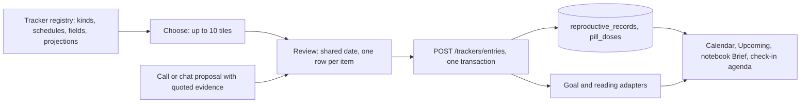

# 0086: Tracker registry and joined logging

Status: proposed, 2026-10-24.

## Context

Record keeping grew one tracker at a time. `reproductive.py` stores period, pill pack and device records as typed JSON in `reproductive_records`, with dated outcomes in `pill_doses`. `health_observations.py` stores one-tap daily values (period flow). `health_milestones.py` stores target and confirmed dates. `goals.py` stores weekly goals, including a medicine goal with dose and unit, and `readings.py` stores measurements. Each has its own form, endpoint and calendar projection.

The Maya v2 prototype (`docs/refs/stellis-demo/`) needs more of the same shape: an iron course with an every-other-day schedule, a fill that runs out on a calculable date, and a pregnancy dated from a transfer with a due date and an optional booked birth. Adding a separate table and page for each would repeat the fragmentation. People also record several things at once ("took my iron, walked, light flow"), and Stellis proposes several entries from one check-in sentence. Today each needs its own form and save.

## Decision

### One registry of tracker kinds

`trackers.py` owns a registry. Each kind declares:

- **Fields:** a typed schema (text, number with unit, date, choice, schedule, supply) with limits and labels. The browser renders forms from this schema. Kind-specific labels, units and choices are never hardcoded in the client.
- **Schedule:** a function answering "is an entry expected on this day?" (daily, every N days, weekdays, pack with break, as needed, none).
- **Log values:** what one dated entry can hold (taken/skipped, a flow choice, a number with unit, done).
- **Derived dates:** calculated points with their inputs, labelled *Calculated* (run-out of a fill, renewal notice, due date, gestational week).
- **Projections:** which surfaces include the kind: calendar track, Upcoming, notebook Brief, check-in agenda.

The first kinds are the existing **period**, **pill pack** and **device**, plus **medicine course** and **pregnancy**. Goals and measurements are registered as *adapters*: they keep their own tables and validation (`goals.mark`, `readings.add`) and expose the same log interface, so joined logging can include them without a migration.

### Storage extends the existing tables

New kinds share `reproductive_records` (id, kind, JSON data) and the dated outcome table `pill_doses` (record id, day, status). The tables keep their names for compatibility. A forward migration adds `notebook_id`, `source_document_id`, `source_page` and `created_at` columns to records and an optional `value` column to outcomes. `reproductive.py` becomes a thin compatibility layer over the registry, so `/reproductive/*` keeps working.

A medicine course stores the medicine, dose amount and unit, schedule, start, optional end, supply (units per fill, units per dose, repeats) and its source (prescription document and page). The run-out date of fill *n* is calculated from the schedule and supply. It is never stored as fact and always carries the *Calculated* label with a link to its source.

A pregnancy stores its dating basis (last period, transfer date and embryo age, or dating ultrasound) and a source. The due date and gestational age are derived. A booked birth date, entered by the person, ends the pending timeline there while the due date stays visible for reference. The timeline projects only pending events: the due date, booked visits and planned tests. Past visits and results stay in Records.

### Joined logging

One component, `tracker-log.js`, records up to ten entries in one action. It has two steps.

1. **Choose.** A grid of tiles, one per active tracked item (each course, pack, device, pregnancy, goal and pinned measurement), grouped by area. Each tile shows its icon, name and today's state from the schedule ("Due today", "Taken", "Not a dose day, next Saturday"). Tapping toggles selection (`aria-pressed`). Selected tiles use the inverted block role. A live count reads "3 selected", and an eleventh tap is refused with "Choose up to 10". A search field appears when more than twelve items exist.
2. **Review and record.** One shared *When* control (Today, Yesterday, or a date and optional time) sits above a stacked list. Each selected item becomes one compact row with its kind's control, prefilled with the usual value (the course's dose, *Had flow*, the measurement's unit). Rows can be removed or edited individually and validate inline. **Save 3 entries** commits them.

`POST /trackers/entries` accepts 1 to 10 entries and applies them in one SQLite transaction. Adapters receive the shared connection, so a failing row saves nothing and returns per-row errors. A success toast offers Undo, which removes exactly those entries.

The same review list is the **proposal** surface. When the check-in call or a chat turn proposes entries, the browser shows the review step with each proposed row checked, its quoted evidence ("From: 'I walked twenty minutes last night'") and the resolved date. **Log selected** saves through the same endpoint. Nothing is saved from a model proposal without that action.

Entry points: the global Add dialog (*Log*), My Health (*Log today*), a notebook's Brief (scoped to that notebook's items), and proposals from calls and chat.

## Consequences

- New tracked things are registry entries, not new pages. Forms, tiles and projections follow from the declaration.
- Calendar `TRACKS` and the dashboard read the registry instead of listing kinds.
- Medicine goals in `goals.py` remain for adherence goals. A course can link to a goal, but the prescription facts (supply, repeats, source) live on the course.
- Derived dates always show their inputs and the *Calculated* label, never as booked care.
- The ten-entry cap is enforced by the API as well as the browser.
