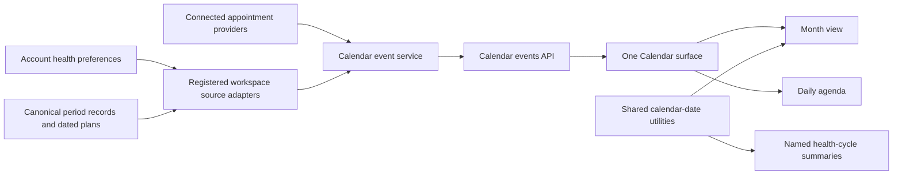

# Shared calendars and health cycles

My Health has one Calendar for appointments, record dates, saved plans and enabled health-cycle entries. One backend date-range projection supplies its month view and daily agenda. Health features supply source adapters and selection actions. Calendar rendering does not depend on reproductive records.

## Components

| Component | Responsibility | Existing consumer |
| --- | --- | --- |
| `src/stellis/shared/calendar-dates.js` | Local date parsing, date keys, calendar arithmetic, month dates and interval indexing | Month calendar, appointment agenda, health cycle summaries and pill schedules |
| `src/stellis/static/health-calendar.js` | Fetch the unified date range and render one month with a daily agenda | My Health Calendar |
| `src/stellis/calendar_sources.py` | Project canonical workspace sources and define track metadata | Shared backend Calendar service |
| `src/stellis/health_preferences.py` | Persist explicit period preferences per account workspace | Settings, onboarding and calendar source gating |
| `src/stellis/static/calendar-view.js` | Month navigation, locale headings, date selection, keyboard navigation, overlapping tracks and shared date headings | Shared My Health Calendar and appointment date utilities |
| `src/stellis/static/calendar-view.css` | Shared calendar layout and interaction states | Month calendar |
| `src/stellis/static/health-cycles.js` | Summaries for arbitrary named collections of recorded episodes and a reusable current-day figure | Menstrual cycle overview |
| `src/stellis/static/health-cycles.css` | Day label, large number, named-cycle caption and start-date context | Current-day figure |
| `src/stellis/static/reproductive.js` | Period, pill and device records and their actions | My Health tracker |

## Calendar inputs

`StellisCalendarView.createMonth` accepts:

- `tracks`: named tracks with `id`, `label` and semantic `color`
- `events`: intervals with `id`, `trackId`, `startDate`, optional inclusive `endDate` and `label`
- `month`, `today`, `locale` and `firstWeekday`: date and presentation context
- `isDateEnabled`: the caller's selection rule
- `onSelectDate`: receives the selected date and every event intersecting it
- `onMonthChange`: receives the displayed month

Several tracks can mark the same day. Each retains its marker and accessible label. The calendar indexes intervals within the displayed range rather than scanning every record for each date. It renders six weeks and supports arrows, Home, End, Page Up and Page Down. Weekday labels use the supplied locale.

The returned object exposes `element`, `updateEvents` and `getMonth`. It performs no data fetches, saves or domain-specific calculations.

## Health cycle inputs

`summarizeCycles` accepts collections of `{id, label, episodes}`. Each episode supplies `startDate` and optional `endDate`. Results include the latest recorded start, current day, observed interval count, average interval and an estimated next start when there is a recorded interval. A cycle with one episode has a current day and no next-start estimate.

These are recorded-start calculations. A feature requiring different rules supplies its own calculation rather than treating this helper as a medical model.

`createDayFigure` accepts the computed day, cycle label and start date. It displays DAY, a larger numeric figure, OF followed by the named cycle, and the recorded start date. It does not draw a progress circle because a cycle day alone has no known progress endpoint.

The menstrual adapter maps saved periods to a calendar track and a named cycle. Future health cycle adapters can supply other event collections without changing calendar geometry, navigation, styles or date arithmetic. This change does not add storage or setup screens for new health cycle types.

## UI placement

Calendar remains visible independently of period tracking. Log period is the primary action in the Calendar header only when the account has opted into period tracking. There is no separate period calendar in the tracking panel. The overview contains the day figure and distinct metric surfaces. End period remains a separate contextual action for an ongoing entry.

## Verification

`tests/test_calendar_dates.cjs` checks leap days, year rollover, daylight-saving boundaries, configurable week starts, overlapping health and appointment intervals, independent cycle summaries and cycles with no estimate. It passes in UTC, America/New_York and Pacific/Auckland.

`tests/browser/calendar_views.mjs` verifies the single shared calendar surface, overlapping tracks from two named cycle fixtures and an appointment, selection of all matching events, month navigation, keyboard focus and responsive layout.

`tests/browser/reproductive.mjs` verifies the tracker integration, the large named-day figure and header-level logging action. It audits the views and forms across five widths and both themes when screenshot and geometry checks are enabled.

## Backend event projection

`GET /api/v1/calendar/events?start=YYYY-MM-DD&end=YYYY-MM-DD&time_zone=IANA-zone` returns date-bounded `events`, active `tracks`, provider `errors` and the queried range. The range is inclusive and bounded to one year. Appointments retain their original provider event for Notes, Notebook and Record actions. All-day provider ends become inclusive dates. Timed dates use the viewing IANA timezone so daylight-saving changes inside a month retain the correct dates and query boundaries. A numeric UTC offset remains available as a compatibility fallback.

`calendar.meetings` owns appointment retrieval, provider failures, saved notes and notebook assignment. The existing `/calendar/meetings` endpoint delegates to it as a compatibility view. The unified event projection uses the same service and registered local source adapters. The old supporting calendar widget is no longer displayed or fetched alongside the shared Calendar.

Local events reference their canonical source IDs and routes. The projection does not duplicate period, device, document or task records into another calendar database. Writes through the tracking editor update their source and refresh the shared Calendar. New cycle types register a source adapter and track metadata in the backend rather than adding labels or calculation rules to the month renderer.

## Period preference

`GET` and `PUT /api/v1/health/preferences` expose the account-workspace `experiences_periods` choice: true, false or unspecified. The same question appears in onboarding before the intake call and in Settings under Health preferences. Only an explicit true shows Cycle and contraception and includes its period and device entries in the calendar feed. Neither changing the preference nor hiding the controls deletes source records. Appointments and other calendar sources remain available.

`tests/test_unified_calendar.py` verifies opt-in, account-workspace isolation, source retention, appointment visibility when periods are disabled, all-day end dates, viewing timezones, partial provider failures and range validation. `tests/browser/health_preferences.mjs` verifies Settings and onboarding persistence, one visible calendar in both preference states and retained tracking records.

## One-tap period logging (23 Oct 2026)

Requested: tracking should resemble the supplied Apple Health Cycle Tracking reference, with one tap per logged day. Inspected the supplied PNG: weekday labels sit above pale vertical capsules, with coral circles for flow. The implementation uses that strip, independent immediate saves for each day, a second tap to undo, previous/next week controls and a date picker. A tap saves `Had flow` without inventing intensity; detailed flow choices remain available. Daily observations continue through the shared calendar projection. Verified with `tests/browser/daily_log.mjs`: three day taps, reload persistence, individual undo, failed-save rollback, existing detailed flow and pill logging, and light/dark layouts at 360, 768, 1024, 1280 and 1920px. Visually inspected the selected-day strip and narrow layout against the supplied reference. Twelve focused observation and calendar backend checks pass.
