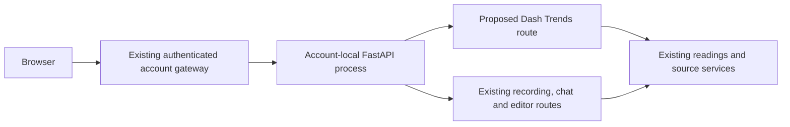

# Dash and Mantine frontend evaluation

Date: 2026-10-24. Owner request: the current tables feel hardcoded; investigate switching to Dash and show a concrete comparison. Evaluation issue: #176. Immediate layout/copy correction: #175.

## Recommendation

Evaluate Trends as the first Dash page. Dash is a viable component framework for measurements and dashboards, and the working prototype confirms native FastAPI hosting. A full app migration would also require deliberate work on the recording, document replay, rich-text editor, chat streaming and navigation lifecycles. Adopting Dash does not decide those interactions or the visual design automatically.

The current production app still uses its JavaScript frontend. The optional prototype is local-only, read-only and synthetic; it does not import the server, authenticate a user, read account databases, write readings or replace `/trends`.

## Working comparison

Run `scripts/dash_trends_preview.py` with the pinned optional dependencies in `scripts/dash-trends-requirements.txt`. It creates a native FastAPI server and mounts Dash on that server without a WSGI adapter, iframe or external hosted service. It uses production measurement definitions and the usual-range helper, but supplies sample values.

- `dmc.AppShell`, `SimpleGrid`, `Paper`, `Group` and `Stack` supply layout and responsive behavior.
- A real `dmc.Switch`, labelled Table at the upper right, replaces the plot with the table.
- `dmc.Table(data=...)` and `TableScrollContainer` render one shared table schema for every measure, with a separate second value for paired blood-pressure readings. `TextInput` and `Select` supply shared search and ordering; Dash callbacks apply them. Sorting/filtering logic is still application code; the component library does not infer it.
- `dcc.Graph` supplies responsive Plotly charts, pointer inspection and paired series. A shared renderer applies the palette, date range and usual-range band.
- Dark-purple and light themes, the approved fonts and measurement categories match the current product direction.
- Every asset and callback in the browser evaluation was local. No Plotly cloud account or paid embedding middleware is needed for this prototype.

The native comparison now has two desktop columns, three vital-sign columns on very wide screens, equal-height cards and upper-right Table switches. It removes possessive usual-range wording from Trends, the overview and camera capture. This addresses the immediate feedback independently of a framework decision.

## Proposed integration

1. Register a Dash route such as `/trends-preview/` on the existing account-local FastAPI app behind the existing session middleware. Reuse readings services and their account data root, rather than keeping a second database or global shared reading store. Preserve demo-generation scoping for Dash callbacks, which currently only applies automatically to `/api/v1/` paths.
2. Keep one navigation shell and theme store across native and Dash routes. Preserve source targets, notebook context, date preferences, range selection, Table state and focus. The prototype has its own comparison shell; it does not establish seamless production navigation.
3. Verify each Dash endpoint and transport through the account gateway. The current WebSocket allowlist only contains call endpoints; the Dash runtime opens `/_dash-ws-callback`, so that path needs a deliberate authenticated relay policy or an explicitly supported HTTP-only configuration. The current gateway has not been tested with Dash callbacks. Do not infer account isolation from this standalone preview.
4. Connect saved readings, source-backed records, daily sleep totals, manual add/delete and camera logging. Check write → reload → table/chart consistency, account isolation and demo reset before changing `/trends`.
5. Measure first-load assets, callback latency and chart responsiveness against the native implementation. Dash adds React, Plotly and component bundles; the prototype establishes functionality, not a production performance advantage. Move additional dashboard pages only after the pilot passes these checks.

## Evaluation evidence and limits

`docs/evidence/dash-trends-preview/` contains desktop/phone chart and table screenshots, twelve responsive layout checks, and a dependency-license manifest. Browser tests cover chart/table controls, shared filtering, newest/oldest ordering, date ranges, both themes, local-only requests and absence of application errors. The native fix has twelve responsive layouts plus the existing fifty-state control audit and 28 helper tests.

The optional preview dependency set is separate from `pyproject.toml` and the shipped runtime lock. Python dependency license metadata identifies FOSS terms for all 42 pinned packages. Dash, Plotly and DMC are MIT; bundled Mantine/React are MIT. DMC includes optional editor components, but this prototype does not use an editor and proposes no Tiptap adoption. Existing self-hosted fonts retain their OFL notices. AG Grid was considered during research and is not included: its Python distribution bundles enterprise assets, whereas this preview needs only the Mantine table.

## Primary references

- [Dash server backends](https://dash.plotly.com/server-backends): native FastAPI backend, existing-server integration, shared APIs and async callbacks.
- [Dash Mantine Table](https://www.dash-mantine-components.com/components/table): data-driven tables, scroll containers and component styling.
- [Dash Mantine Switch](https://www.dash-mantine-components.com/components/switch): controlled `checked` state and callbacks.
- [Dash API reference](https://dash.plotly.com/reference): route prefixes and local asset serving.
