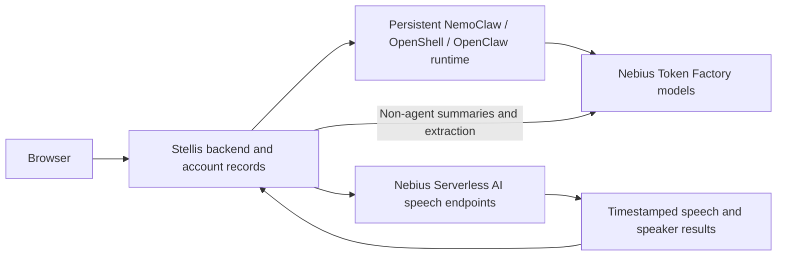

# Nebius cloud integration

Owner direction: “Following this, we are going back to integration of nebius token factory and nemoclaw on token factory with serverless nebius cloud for speech inference.”

The explicit local/cloud launch split is the first step. The following cloud integration is the next workstream; it is not marked deployed or verified by the launch changes.

## Component boundaries

Token Factory supplies model inference to NemoClaw's configured provider. The managed agent runtime has its own host, credentials, sessions and tool policies. Speech workers are separate services. Local mode retains GN100 Ollama and local speech; cloud mode must not silently fall back to those services.

## Token Factory and managed agents

Verify the owner's project, model access and separate application/provider credentials. Configure the actual cloud NemoClaw runtime to use Token Factory. Keep its gateway behind authenticated TLS and retain account binding. Verify a real source-cited agent response through `/v1/responses`, managed tool execution, cancellation, restart persistence and credential isolation. Test the managed runtime directly; the isolated demo's direct inference path is insufficient evidence.

## Serverless speech

Nebius documents [Serverless AI Endpoints](https://docs.nebius.com/serverless/endpoints/manage) for custom model containers behind managed HTTP endpoints, and [Jobs](https://docs.nebius.com/serverless/jobs/manage) for finite workloads. This is infrastructure for deploying speech models, not evidence of a ready-made speech API or compatibility with Stellis's streaming protocol.

First establish the endpoint contract and deployment configuration for:

- Streaming recognition used by recording and calls: confirm streaming transport support, reconnect behavior and latency before selecting a serving path.
- Saved-recording transcription, timestamps, alignment and diarization: preserve the current passage format and confirmed Person mappings.
- Speech synthesis for calls: preserve interruption and response draining; verify model availability and voice behavior separately from ASR.

Package the selected FOSS speech models in a reproducible worker image with explicit versions and health checks. Define authenticated requests, bounded uploads, deadlines, cancellation, concurrency limits, result validation and trace metadata. Audio and transcript content must stay outside request logs. Configure speech credentials separately from Token Factory and the agent gateway. Expose an explicit backend choice only once that adapter exists; do not add an environment flag that is ignored by the current workers.

Before provisioning, identify the project, endpoint region, GPU preset, registry, storage needs, model licenses and cost limits. Confirm the service's actual scaling and idle behavior; do not assume scale-to-zero from the word serverless. Keep the app's durable account storage outside ephemeral workers. Provisioning and deployment require a separate explicit deployment request.

## Completion evidence

A cloud release needs real project-backed Token Factory and NemoClaw responses, a deployed speech worker, full recording and call checks, timestamps and speakers retained after reload, interruption and cancellation checks, concurrency and cold-start measurements, and no silent fallback. Record configuration, deployed image revisions and observed checks separately from unit tests or simulated provider responses.
